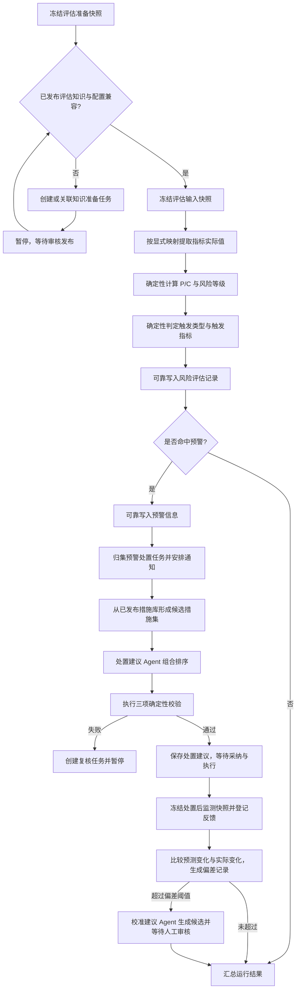

# RiskFlow 风险评估、预警与处置引擎

> 状态：Wayfinder 已确认的规划基线。
>
> 本文定义领域事实、工作流和 MVP 深度，不替代后续 OpenSpec 正式规格。

## 1. 已继承且不重复决策的约束

- `assessmentGraph` 只编排版本化 DTO、标识、暂停、恢复、重试和人工复核路由；领域事实仍由知识建模、风险评估、预警处置和复核审计模块拥有。
- 普通评估只能消费已发布的适用规则集、指标映射、权重、风险矩阵、风险可接受阈值、监测预警阈值和措施库版本。缺少或不兼容时等待治理流程，不允许 LLM 临时选择规则。
- Agent 只用于非结构化知识编制、在已发布措施候选集中组合与排序处置建议，以及偏差超阈值后的校准建议候选。普通评分与预警不运行 Agent；指标映射、规则一致性、适用性匹配、P/C、矩阵、阈值和三项处置约束均为确定性领域逻辑。
- 风险评估记录、预警信息、处置建议、反馈、偏差记录和校准建议是不可变事实；通知、复核、处置执行是过程任务。历史只追加，不覆盖。
- 预警信息可靠入库后立即在工程内生效；确认只表示已读并接管。通知失败不得回滚预警。
- 校准建议只能创建受治理定义的新修订，不能自动改写当前生效规则、权重、阈值或矩阵。

## 2. 模块缝隙

图节点只调用下列用例级深模块接口，不直接读取存储、解析规则或计算分值：

1. **知识建模模块**：准备并发布评估知识，拥有指标体系、结构化评分规则、适用规则集、矩阵、阈值和措施库版本。
2. **风险评估模块**：冻结评估依据、提取指标实际值、确定性计算 P/C 与风险等级，并生成风险评估记录。
3. **预警处置模块**：判定预警、归集预警处置任务、生成并校验处置建议、记录反馈、偏差与校准建议。
4. **复核审计模块**：创建类型化复核任务、接收决定、恢复原运行并追加审计事件。
5. **Agent 任务模块**：按任务策略运行知识编制、处置建议和校准建议 Agent，拥有任务、原始输入输出、工具调用、预算消耗和类型化增量工件，不拥有评估、预警或处置业务事实。

存储、模型、趋势预测和通知位于模块内部缝隙，以生产适配器和本地测试适配器实现；这些内部缝隙不扩张图状态或模块公开接口。

## 3. 编排骨架



规则条文结构化与适用规则集发布是独立的受治理流程。普通评估只检查并引用其结果；缺失时暂停并关联该流程，发布完成后继续原 `threadId` 并重新校验精确版本。

## 4. 已确认：触发指标在风险评估记录入库前形成

项目字段契约要求不可变的风险评估记录包含 `triggerIndicators`。既有功能原型同时规定“风险评估记录可靠入库后再检查预警阈值”。如果按该顺序实现，第一次入库时尚无触发指标，后续只能回写记录或生成第二份评估事实，都会破坏不可变性和单一事实源。

在风险评估模块内部先完成 P/C、风险矩阵与全部 RA-S6 触发判定，再原子写入最终风险评估记录；预警处置模块随后只根据该记录中已经冻结的触发判定创建预警信息。外部通知仍严格发生在预警信息可靠入库之后。

这样保留三个顺序约束：

1. 风险评估记录首次写入即完整、不可变，含触发指标集合；
2. 预警信息一定引用已经可靠入库的风险评估记录；
3. 通知一定晚于预警信息入库。

未命中任何条件时，风险评估记录仍保存空的触发指标集合和所用触发策略版本，以便重放能够证明“已判断但未触发”。

## 5. 已确认：MVP 真实运行规则结构化与发布

既有规划要求 MVP 以导入甲方确认的版本化配置包为主，不建设通用规则设计器；同时，MVP 又必须覆盖 RA-S3、RA-S4，并证明非结构化条文的 Agent 编制、规则一致性校验、适用性匹配和人工发布不是纸面能力。

MVP 采用“双路径、同一事实源”：

- 日常评估路径导入甲方确认的小规模指标、量化标准、权重、矩阵、阈值和规则配置包，核对后发布；
- 甲方已确认版本化配置包的精确导入不启动 Agent，导入结果仍须核对并经人工发布；
- MVP 验收另选至少一条真实或甲方认可的非结构化规范条文，真实跑通“知识编制 Agent 生成结构化评分规则增量 → 确定性 Schema 与适用条件校验 → 冲突/重叠检测 → 人工审核 → 形成适用规则集发布版本 → 被一次风险评估精确引用”；
- 两条路径最终都形成同一类结构化评分规则、适用规则集和发布审计事实，不维护导入规则与模型规则两套领域模型；
- MVP 可以限制为单规范、小规则集和有限编辑界面，不承担通用批量规则编制平台。

验收证据必须至少包含一条规范条文的原始证据定位、Agent 任务策略、模型与提示模板、工具白名单、预算、原始输出、结构化增量、确定性校验结果、人工决定、适用规则集发布版本及其被一次风险评估精确引用的链路。只导入预制规则包并直接评分不能证明 RA-S3、RA-S4 已经落地。

## 6. 已确认：P/C 使用受控、版本化聚合策略

甲方尚未提供最终指标体系、权重和 P/C 聚合公式，因此当前不能假定线性加权求和、取最大值或其它具体算法。系统又必须保证评分配置化、确定性和可重放，不能把公式散落在图节点或业务调用点。

风险评估模块提供一个小型深接口：输入完整的评估输入快照引用，输出风险评估结果或结构化业务阻断。指标取值、单位校验、基础分映射、必需指标检查、P/C 聚合、舍入、矩阵映射和触发判定全部隐藏在模块内部，并保存逐步形成依据。

聚合算法采用受控、版本化的评分策略类型：

- MVP 只实现甲方最终确认的一种策略；甲方数据到位前，开发与演示使用显式标注“合成样本、待甲方复核”的同形策略版本；
- 数值、权重、分级区间、舍入规则和矩阵全部来自不可变配置，不写入 TypeScript 分支；
- 不在 MVP 中建设可执行任意表达式、JavaScript 或通用公式 DSL；
- 完整产品仅在出现第二种真实、经审核的聚合规则族时增加新的受控策略类型，所有策略仍通过同一评估模块接口和相同结果契约；
- 缺少必需指标、单位不兼容、版本不配套或策略类型不受支持时，不生成部分有效的 P/C 与风险等级。

该接口的稳定测试面是“相同输入快照和版本产生相同完整结果或相同结构化阻断”，不锁定内部计算步骤的函数拆分。

## 7. 已确认：预警事实分立，预警处置任务按风险与空间归集

一次风险评估可能同时命中风险等级、监测数值、趋势异常和多指标联合规则；后续监测快照还可能持续产生新的预警信息。如果每条预警都新建处置任务，现场会面对同一风险的一组重复任务；如果把所有预警合成一条记录，又会丢失每次触发的独立证据和时间。

采用“预警事实分立、处置任务归集”：

- 每个风险评估记录按命中的触发类型分别生成不可变预警信息；同一触发类型下可以包含多个触发指标；
- 预警处置任务的归集键固定为“工程 + 风险稳定身份 + 处置空间范围”；风险稳定身份为 `riskRecordId` 或 `externalRiskEventId`，处置空间范围取本次评估冻结的单一规范化范围引用；
- 同一归集键只要存在尚未关闭的预警处置任务，新预警就关联该任务，不再依赖固定时间窗口；
- 触发类型、触发指标、风险等级和风险记录版本不参与任务身份。新类型、新指标或等级升高作为任务内新增预警或升级事件保留；
- 任务完成或取消后再次越限，创建新的预警处置任务，并引用上一个任务作为历史上下文；
- 同一风险在不同处置空间范围分别建任务，避免跨现场责任范围混在一起；需要协同处置时通过任务关联表达，不改变各自事实归属；
- 同一风险评估记录和触发类型使用业务幂等键，LangGraph 重试不得重复生成预警信息或任务关联。

任务关闭必须由有权限的人员基于处置执行与反馈作出决定；监测值回落可以形成解除依据，但不自动删除预警或关闭现场任务。

## 8. 已确认：处置效果预测是独立事实，偏差采用冻结的同口径基准

处置建议形成后到现场反馈到达前，规则、权重、矩阵和监测数据都可能发布新版本。如果直接拿“当前最新等级”与历史预测比较，偏差会同时混入处置效果和规则变更，无法判断误差来自措施、数据还是评分口径。

**处置效果预测**是预警处置模块拥有的独立、不可变事实，精确引用处置建议版本，并采用以下契约：

- 预测必须发生在处置执行前，冻结处置前监测快照、预测时间范围、目标指标、适用性元数据、评分映射/权重/矩阵版本、预测策略版本和证据；
- 预测先给出目标指标在指定时间范围内的预计值或区间，再通过冻结的评分策略计算预计 P、C 与风险等级变化；LLM 不直接预测数值、P/C 或风险等级；
- MVP 只实现一种经样例验证的确定性监测趋势预测策略。甲方数据到位前使用明确标注“合成样本、待甲方复核”的策略与样例；完整产品出现真实需求后，可通过同一接口增加历史统计或工程机理策略；
- 现场反馈到达后冻结处置后监测快照，并使用预测时冻结的同一套评分依据计算实际风险变化，生成同口径偏差记录；
- 若反馈时已有新规则或矩阵，系统可以另建当前口径的重新评估记录，但该记录不参与本次偏差计算；
- 数据覆盖不足、目标时间范围未到或预测策略失败时，保存结构化“预测不可用”原因，不编造偏差或校准建议；选定的 MVP 验收样例必须具备足够数据，真实跑通一次预测、反馈、偏差、校准建议和人工发布闭环；
- 偏差超过冻结的偏差阈值策略时必须启动校准建议 Agent；Agent 只能在偏差记录、证据和受治理定义范围内返回类型化修订建议增量，不能直接修改数值或发布版本。增量经确定性引用与 Schema 校验后形成待审核校准建议，仍须人工审核并由治理流程创建新版本。

独立事实使同一处置建议可以保留预测依据、失败原因和后续比较引用，也避免把预测结果混入可变的预警处置任务状态。

## 9. 已确认：校验失败不可人工强行通过，现场行动保持独立

三项校验分别保护触发指标一致性、规范合规性以及现场资源与工序约束可执行性。如果复核人可以直接把失败结果标成“已通过”，系统会留下一个名义合规、实际仍违反约束的处置建议；如果系统阻止一切计划外行动，又可能妨碍现场在紧急情况下先行处置。

系统建议与现场行动使用不同事实表达：

- 处置建议 Agent 组合排序后的结果在三项校验全部通过前只属于运行工件“处置建议候选”，不能形成正式处置建议；Agent 只能返回措施选择、顺序、资源需求和目标指标等任务专属增量，不能新增措施库外条目；
- 任一校验失败时创建复核任务。复核人可以在已发布措施集合内调整措施、顺序、资源和目标，或把问题退回措施治理、工程上下文或资源信息修订流程；新候选必须重新执行全部校验；
- 任何角色都不能用人工决定覆盖失败结果并将其标记为合格处置建议，规范禁止项尤其不可豁免；
- 处置建议通过校验后仍不是施工指令，工程风险管理员可以采纳、不采纳或选择已发布措施另行形成现场采用方案，决定与理由单独保存；
- 紧急情况下，现场可以独立采取措施并事后登记实际行动、决定人、业务发生时间、原因和证据。该记录明确标注“现场独立行动”，不得伪装成系统处置建议，也不得自动写入措施库；
- 现场独立行动可以触发后续监测快照和当前风险重新评估。若执行前没有合法的处置效果预测，则不为该次行动编造偏差记录或校准建议；
- 认为现场行动值得复用时，只能据此创建新的措施项草稿，重新走校验、审核和发布流程。

这一边界既不让系统替代现场指挥，也不允许人工复核破坏规范合规与审计真实性。

## 10. 领域事实与所有权

| 模块 | 拥有的事实或工件 | 只能引用、不得复制的内容 |
|---|---|---|
| 工程数据模块 | 适用性元数据快照、监测快照、工程资料与外部风险事件接入事实 | 标准化风险记录、评估规则、风险等级 |
| 知识建模模块 | 指标与字段映射、结构化评分规则、适用规则集、权重、评分策略、风险矩阵、两类阈值、联合触发策略、措施库、预测与偏差策略的受治理版本 | 工程元数据快照、风险评估记录 |
| 风险评估模块 | 评估准备快照、评估输入快照、指标实际值与评分明细、风险评估记录 | 标准化风险记录或外部风险事件、监测快照、知识发布版本 |
| 预警处置模块 | 预警信息、预警处置任务、处置建议候选工件、处置建议、处置效果预测、现场处置执行记录、处置反馈、偏差记录和校准建议 | 风险评估记录、措施与阈值版本 |
| Agent 任务模块 | Agent 任务、可重建输入、原始模型输出、工具调用、预算消耗、类型化增量与校验结果 | 结构化评分规则、风险评估记录、预警信息、处置建议和校准建议 |
| 复核审计模块 | 复核任务、类型化决定信封和审计事件 | 被复核对象的精确版本 |
| LangGraph 工作流模块 | 有限运行、阶段、检查点、错误、路由与结果引用 | 以上全部业务事实正文 |

结构化评分规则草案和处置建议候选是尚未通过治理或校验的工件，不能进入常规评分、预警统计或现场建议列表。适用规则集、风险评估记录、预警信息和处置建议只有一套正式事实，不因界面、Agent、导入或 LLM 入口而分叉。

## 11. 版本化快照与图状态

### 11.1 `AssessmentPreparationSnapshotV1`

一次评估、重新评估或历史补算先冻结准备快照：

```text
schemaVersion
projectId + projectRevisionRef
spatialScopeRef
riskInput =
  | { kind: standardizedRiskRecord, riskRecordVersionRef }
  | { kind: externalRiskEvent, externalRiskEventRef }
applicabilityMetadataSnapshotRef
monitoringSnapshotRef?
sourceEvidenceRefs[]
entryMode + triggerReason
previousAssessmentRecordRef?
causalRunRef?
createdBy + createdAt
```

`riskInput` 使用可辨识联合类型保证二选一且仅一个。准备快照只证明业务输入已经冻结；知识版本尚未齐全时不能直接评分。

### 11.2 `AssessmentInputSnapshotV1`

知识就绪后，风险评估模块基于准备快照形成最终输入快照，至少冻结：

```text
schemaVersion
preparationSnapshotRef
indicatorDefinitionReleaseRef
indicatorFieldMappingReleaseRef
applicableRuleSetReleaseRef
weightReleaseRef
scoringStrategyReleaseRef
riskMatrixReleaseRef
riskAcceptanceThresholdReleaseRef
monitoringWarningThresholdReleaseRef
jointTriggerPolicyReleaseRef
measureLibraryReleaseRef
warningAggregationPolicyRef
notificationPolicyRef
responseGenerationPolicyRef
responseValidationPolicyRef
responseAgentPolicyRef
effectForecastPolicyRef
deviationPolicyRef
calibrationAgentPolicyRef
modelDeploymentRef + promptTemplateRef
retryPolicyRef + reviewPolicyRef
createdBy + createdAt
```

所有引用都是精确、不可变版本。后续发布不会改变既有快照；要采用新版本必须创建新的重新评估或处置运行。

### 11.3 `AssessmentGraphStateV1`

```text
schemaVersion
graphVersion
parentRiskFlowRunId
runId + threadId
entryMode
actorRef
entrySnapshotRef
status + stage
assessmentInputSnapshotRef?
assessmentRecordRef?
warningRecordRefs[]
warningResponseTaskRefs[]
recommendationCandidateRef?
agentTaskRefs[]
responseRecommendationRef?
effectForecastRef?
executionRecordRef?
feedbackRef?
deviationRecordRef?
calibrationSuggestionRef?
reviewTaskRefs[]
lastRouteDecisionRef?
lastErrorRef?
resultRef?
```

`entryMode` 至少支持初次评估、重新评估、历史补算、处置效果预测和处置反馈。图状态不保存风险事件正文、完整规则、指标明细、模型响应、建议正文或监测序列，只保存编排所需引用。

## 12. 规则准备与 `assessmentGraph` 阶段

### 12.1 评估知识准备流程（RA-S2～RA-S4）

规则治理是独立的有限流程，常规评估不在运行中临时编规则：

1. 导入甲方配置或登记规范条文及证据定位；
2. 对甲方已确认版本化配置执行精确导入时不启动 Agent；对规范条文等非结构化来源必须通过统一 Agent 任务模块生成任务专属结构化评分规则增量；
3. 确定性校验 Schema、适用性三维字段、指标引用、单位、阈值区间、例外条款和证据；
4. 检测冲突、覆盖重叠和无法可靠量化的表述，形成结构化说明；
5. 人工修正、通过或退回草案，发布规则精确版本；
6. 对工程适用性元数据快照执行严格匹配，保存入选与筛除原因；
7. 审核并发布适用规则集，冻结规则成员、元数据快照、生成时间和审计信息。

普通评估发现发布物缺失、不兼容或停用时，创建或关联知识准备任务并暂停；发布完成后恢复原 `threadId`，重新校验精确版本，再形成评估输入快照。

### 12.2 初次评估、重新评估与历史补算（RA-S1～RA-S6）

| 阶段 | 专利追踪 | 行为与输出 |
|---|---|---|
| A0 输入准备 | RA-S1 | 校验风险输入联合类型，冻结工程修订、空间范围、适用性元数据和监测快照，形成准备快照 |
| A1 知识就绪 | RA-S2～RA-S4 | 校验所有发布版本及相互兼容性；缺失时关联知识准备任务并暂停 |
| A2 输入冻结 | RA-S1～RA-S4 | 形成不可变评估输入快照，后续节点不得切换版本 |
| A3 指标取值 | RA-S5 | 按显式字段映射读取工程资料与监测摘要，校验单位、时效、必需性与证据，形成指标实际值工件 |
| A4 评分与触发判定 | RA-S5、RA-S6 | 使用受控评分策略映射基础分、计算 P/C、舍入、映射矩阵，并确定性计算全部触发类型和触发指标 |
| A5 评估入库 | RA-S5、RA-S6 | 原子写入完整风险评估记录，未触发时保存空集合及判定策略版本 |
| A6 预警入库与归集 | RA-S6 | 按命中的触发类型幂等写入预警信息，关联或创建预警处置任务，并可靠安排通知任务 |
| A7 处置建议候选 | RA-S7 | 从已发布措施库确定性形成候选集；候选为空时转人工编制，否则必须由处置建议 Agent 在候选集内组合排序并返回类型化增量 |
| A8 约束校验与建议入库 | RA-S7 | 执行三项确定性校验；全部通过才写入处置建议，否则保存候选、创建复核任务并暂停 |
| A9 结果汇总 | RA-S1～RA-S7 | 汇总评估、预警、任务、建议、复核、通知安排与错误引用，结束本次有限运行 |

没有命中预警时，运行在 A5 后直接进入 A9。通知执行失败不回滚预警；候选措施为空不允许 Agent 自由补造措施。A3～A6 的普通评分与预警路径不创建 Agent 任务。

### 12.3 处置效果预测入口（RA-S7）

处置建议被采纳后、现场执行前，创建独立有限运行：校验采纳决定与任务状态，冻结处置前监测快照和预测依据，执行版本化确定性预测策略，保存处置效果预测。预测不可用时保存原因并结束，不阻塞现场独立决定，但不得产生伪造预测。

### 12.4 处置反馈入口（RA-S7）

现场执行形成现场处置执行记录后，反馈入口依次：冻结处置后监测快照 → 保存处置反馈 → 按处置效果预测冻结的评分依据计算实际变化 → 生成偏差记录 → 按偏差策略判断阈值。超过阈值时必须运行校准建议 Agent，校验其类型化增量后生成待审核校准建议与复核任务；未超过阈值时显式跳过。当前生效规则下的重新评估由独立运行产生，不混入偏差。

每个运行都有明确起止。`assessmentGraph` 不跨越数日等待现场执行；建议采纳、现场执行和反馈分别通过正式领域命令触发后续有限运行。

## 13. 路由、失败与恢复

| 情况 | 路由 | 是否生成正式事实 |
|---|---|---|
| 适用规则集或配置缺失、不兼容 | 关联知识准备任务并暂停 | 只保存准备快照和过程任务 |
| 规则无法可靠结构化、冲突或重叠 | 规则复核 | 不发布规则或适用规则集 |
| 必须的知识编制、处置建议或校准建议 Agent 失败/预算耗尽 | 仅按冻结任务策略重试，耗尽后失败 | 不跳过 Agent、不切换策略、不生成对应正式事实 |
| 必需指标缺失、单位不兼容、数据过期 | 上游数据/配置修正；需要判断时进入复核 | 不生成部分 P/C 或等级 |
| 评分与触发判定完整 | 可靠写入风险评估记录 | 是，包含空或非空触发指标集合 |
| 未命中预警 | 运行完成 | 只有风险评估记录 |
| 命中一种或多种触发类型 | 分别写入预警并归集任务 | 是，先预警后通知 |
| 候选措施为空 | 人工现场方案或措施治理 | 不让 Agent 自由生成正式建议 |
| 处置建议候选校验失败 | 复核、修订、重新校验 | 不生成正式处置建议 |
| 现场独立行动 | 登记执行记录与反馈 | 不伪装为处置建议；无预测则无偏差 |
| 预测或反馈数据不足 | 保存结构化不可用原因 | 可保存反馈，不编造偏差或校准建议 |
| 偏差超过阈值 | 校准建议 Agent 生成候选，经校验后进入复核 | 不自动修改当前版本 |
| 模型、存储或通知瞬时失败 | 按冻结策略重试 | 不创建业务复核代替技术修复 |

错误至少记录错误码、类别、阶段、是否可重试、尝试次数、策略版本、诊断引用、发生时间和因果运行标识。错误文案不作为程序分支或稳定测试契约。

恢复沿用原 `threadId`、入口快照和精确版本。规则结构化、Agent 任务、评分入库、预警入库、任务归集、建议入库、通知意图、预测、偏差和校准建议分别使用稳定业务幂等键；节点从头重跑时先查询已有工件或事实。Agent 重试不得突破冻结的模型/工具调用、上下文、输出、候选、修复轮次、墙钟时间、模型和并发上限。需要切换资料、规则、模型、工具、预算、策略或矩阵版本时创建新运行，不能伪装成旧运行恢复或审计重放。

## 14. 重新评估与当前风险投影

以下变化生成明确的待重新评估原因：监测快照更新、适用性元数据变化、适用规则集发布新版本、权重/评分策略发布新版本、风险矩阵发布新版本。每次重新评估都创建新的风险评估记录并引用前次记录、触发原因和新旧版本。

MVP 由工程风险管理员显式确认并启动；完整产品可以按工程策略自动创建相互独立的批量运行。历史记录不覆盖，“当前风险等级”仍由查询投影按效力、业务时间和系统记录时间选择。

## 15. 完整产品与 MVP 深度

| 能力 | MVP | 完整产品 |
|---|---|---|
| 风险输入 | 主验收路径使用标准化风险记录；Schema 保留外部风险事件联合类型 | 两种输入均提供完整界面、权限与证据链 |
| 规则治理 | 导入甲方确认的小配置包；至少一条规范真实跑通知识编制 Agent、校验、审核、适用规则集发布和评分引用 | 多规范、批量差异、冲突治理、项目规则集比较与回滚 |
| P/C 与矩阵 | 一种甲方确认的受控评分策略；无数据时使用标注清楚的同形合成版本 | 出现真实规则族后扩展受控策略类型，不提供任意代码公式 |
| 指标与监测 | 至少一条地表沉降序列跑通实际值、斜率、加速度、异常评分、评分与预警 | 扩展全部业务指标、批量与实时接入，仍使用冻结快照 |
| 预警 | 实现四种触发类型、可靠入库、任务归集和应用内通知；验收样例至少真实命中一种 | 配置驱动责任人与外部渠道、升级策略和多工程运行 |
| 处置建议 | 小规模已发布措施库，真实处置建议 Agent 组合排序和三项校验，通过后自动形成正式建议并等待人工采纳 | 扩展措施治理、跨范围协同和更多资源/工序约束 |
| 效果预测与反馈 | 一种确定性监测趋势策略，真实完成预测、执行反馈、偏差、校准建议 Agent、人工审核和新版本发布 | 按真实需求增加历史统计或工程机理策略及批量校准分析 |
| 自动化 | 初评、重评、采纳、执行和反馈由用户显式触发；技术重试自动 | 可按工程策略事件驱动重评估和批量受影响运行 |
| 规模与部署 | 单工程、单 Worker、单机私有部署；保留全部版本、幂等、复核和审计语义 | 多工程、可扩 Worker、完整外部集成和运维治理 |

MVP 不建设通用规则设计器、任意公式 DSL、自由措施生成、自动校准或绕过校验的人工特权。MVP 的限制是规模和策略数量，不裁剪 RA-S1～RA-S7 的可运行闭环。

## 16. 专利追踪

| 专利步骤 | 对应阶段与流程 | 主要持久化结果 |
|---|---|---|
| RA-S1 | A0、A2 | 风险输入联合类型、适用性元数据快照、监测快照、评估准备/输入快照 |
| RA-S2 | 评估知识准备、A1 | 指标体系、字段映射、量化标准、权重与适用约束发布版本 |
| RA-S3 | 评估知识准备 | 条文证据、模型草案、结构化评分规则、校验与审核记录 |
| RA-S4 | 评估知识准备、A1 | 冲突说明、入选/筛除原因、适用规则集及元数据快照 |
| RA-S5 | A3～A5 | 指标实际值、评分明细、P/C、矩阵格、风险等级与完整风险评估记录 |
| RA-S6 | A4～A6 | 触发判定、触发指标、预警信息、归集任务与通知状态 |
| RA-S7 | A7～A9、预测入口、反馈入口 | 处置建议候选、三项校验、处置建议、处置效果预测、执行记录、反馈、偏差、校准建议与审核 |

## 17. 深模块接口与验证面

工作流节点只依赖少量用例级接口：

- 知识建模模块：给定准备快照，返回完整评估依据版本集，或返回需要等待的知识准备任务；
- 风险评估模块：给定评估输入快照，返回完整风险评估记录引用，或返回结构化业务阻断；
- 预警处置模块：给定“评估已记录、建议已采纳、现场反馈已登记”三类可辨识命令之一，推进相应预警、建议、预测或偏差事实；
- Agent 任务模块：给定任务类型、冻结上下文和策略引用，返回经记录的任务专属增量或结构化失败；领域模块独立校验并决定是否应用，不允许 Agent 直接写业务事实；
- 复核审计模块：给定复核任务与类型化决定，写入决定并返回应恢复的运行引用。

P/C、矩阵、触发判定、三项约束与趋势预测属于进程内确定性实现，不为每个函数暴露端口。模型网关、持久化和外部通知具有生产与测试两种适配器，作为模块内部缝隙注入，不扩张外部接口。

稳定验证面包括：同输入同版本重放、必需指标阻断、四类预警触发、预警任务归集、三项校验、通知失败不回滚、预测同口径偏差、校准不自动发布、暂停恢复与业务幂等。测试不锁定节点调用顺序、提示词文本、错误文案或内部函数拆分。

## 18. 整体验收清单

本规划已把 Agent-native 决策与既有约束合并为一套当前状态：

1. 触发指标在风险评估记录入库前确定，预警在评估记录之后入库，通知在预警之后执行；
2. MVP 同时保留配置包日常路径和至少一条规范的真实结构化、审核、发布与评分引用证据；
3. P/C 使用受控、版本化策略，MVP 不建设任意公式 DSL；
4. 预警事实分立，预警处置任务按工程、风险稳定身份和处置空间范围归集；
5. 处置效果预测是独立事实，偏差使用预测时冻结的同口径评分依据；
6. 校验失败不可人工强行通过，现场独立行动另行如实登记；
7. 普通 P/C、矩阵和预警不运行 Agent；非结构化知识编制、处置建议和超阈值校准建议使用同一 Agent 任务模块的任务专属策略；
8. 必须的 Agent 任务失败不得跳过或静默降级，任务只返回类型化增量，正式事实仍由领域模块校验与写入；
9. Agent 任务保留可重建输入、原始输出、工具与预算记录，不保存模型内部思维链。

本文作为后续完整界面规格、存储方案、质量评测、MVP 验收和 OpenSpec 实施路线的输入。
