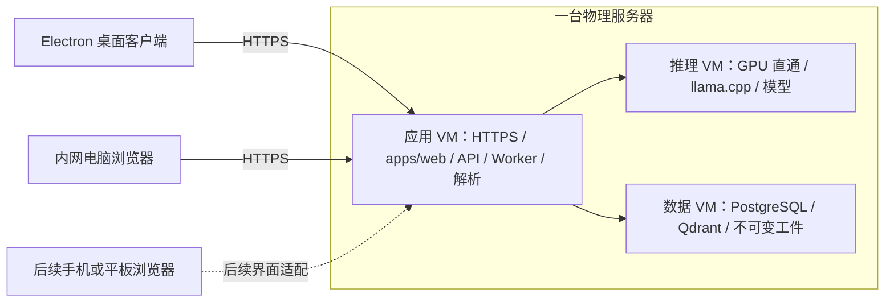

# RiskFlow 桌面客户端与多终端架构

> 状态：2026-10-08 用户确认的目标设计，待 C37 实施。正式行为契约由 C37 delta specs 承担，当前代码尚未包含 Electron 客户端。

## 产品形态

RiskFlow 采用 Electron 桌面客户端连接甲方内网的集中式服务。Electron 加载应用虚拟机提供的 HTTPS 页面；完整业务界面统一实现于 `apps/web`，电脑浏览器直接访问同一入口。客户端不承载 API、Worker、数据库、检索索引或模型推理。

这条路线沿用现有 HTTP API、同源 Cookie 和 SSE，避免为桌面交付增加第二套业务通信与界面。Electron 安装包与服务端发布分别管理；界面随服务端发布，不要求用户因普通页面更新重新安装客户端。

## 目录与职责

| 区域 | 职责 |
| --- | --- |
| `apps/web` | 唯一业务 UI、路由、会话、工程上下文、图表、确认交互、HTTP 与 SSE 客户端 |
| `apps/desktop` | Electron 主进程、窗口、部署入口读取、连接失败页与平台安装包；首期无特权 preload |
| `apps/api` | 鉴权、领域命令与查询、SSE、安全 HTTP 边界 |
| `apps/worker` | LangGraph、Agent、Outbox 与已归档后台任务 |
| `packages/contracts`、`core`、`adapters` | 既有契约、领域事实与基础设施适配，保持单向依赖 |

目标 workspace 是四个应用与三个共享包，继续使用根 pnpm 锁文件与统一构建。Desktop 通过 HTTPS 加载 Web；应用之间不导入彼此源码，不将 Web 加入 Desktop 的 npm 依赖。`demo/` 保持在生产依赖图之外。

三 VM 以 systemd 管理服务，应用 VM 使用 Caddy 2.11.7 提供同源 HTTPS；数据 VM 的 PostgreSQL 18.6 与 Qdrant 1.19.0 使用固定 OCI 制品。C04 存储留在数据 VM 本地磁盘，应用 VM 通过仅提供 put/open 的内部 HTTPS 流接口访问；事务引用检查仍共享原 PostgreSQL 事务，维护核对在数据 VM 本地进行。

`demo/src` 的已实现业务接线与 `demo/v2` 的视觉参考用于迁移，最终页面接入 `apps/web` 的现有会话、HTTP/SSE、导航与确认机制。原型静态业务数据、审阅注入和冻结契约镜像不作为生产数据来源。保留 C32–C35 的全部业务行为，并合并 C36 质量页面；不因桌面交付遗漏页面。路由复用 React Router 6.30.6，图表复用 ECharts 5.6.0；使用已有 Web 壳、唯一 HTTP 客户端和确认控制器，质量页位于 `/assessment/quality`。

## 通信、身份与本机能力

业务页面、API 与 SSE 使用同一 HTTPS origin。桌面客户端使用自己的 Electron 会话容器；浏览器与桌面的登录状态各自独立，授权均由服务器判定。不把密码、会话密钥、数据库或模型凭据写入安装包或桌面配置。

主进程从受控部署配置读取唯一 HTTPS origin，按 URL 的协议、origin 和用途验证导航；禁止任意页面借客户端能力访问本机。Renderer 关闭 Node 集成，开启 context isolation 与 sandbox，并使用生产 CSP。窗口跳转、新窗口、下载和外部链接按明确用途处理。证书由目标系统信任链验证，私有 CA 通过部署流程配置信任，不关闭 TLS 验证。

首期复用浏览器文件选择和下载能力。确有本机需求时，preload 只提供具体且有界的接口，主进程验证调用页面和参数；不暴露通用 IPC、Shell、任意文件读写或业务命令代理。窗口关闭只结束客户端连接，已受理任务继续由服务端执行；取消任务仍须提交正式业务命令。

服务器不可达或证书校验失败时显示本地连接状态与显式重试入口。重连后重新验证会话、按既有游标恢复订阅；未知是否已受理的写命令不因重连自动重新提交。客户端不缓存工程正文作为离线事实，也不维护待同步写队列。

## 多平台与发布

C37 冻结 Windows 11 x64（NSIS）、Ubuntu 24.04 x64（AppImage）与 macOS 14+ arm64（DMG），使用 Electron 44.7.0 与 electron-builder 26.15.3；内置 Chromium 152.0.7977.130 / Node 24.21.0。Windows 组织签名、macOS Developer ID 与预附公证票据、Linux 介质核验分别在真实目标环境验收；一个平台的构建或浏览器测试不能证明其它平台可安装运行。Electron 的 Chromium 与内置 Node 身份随安装包记录，服务端 Node 24 约束不替代 Electron 运行时身份。

安装包、配置说明、哈希、许可证与 SBOM 纳入离线介质，不依赖公网更新源。客户端升级采用人工安装已核验版本；服务端发布与客户端发布各自记录兼容性，普通页面更新由服务端完成。敏感工程信息不进入桌面诊断。

手机和平板优先复用 `apps/web` 与同一 API，通过浏览器访问；Electron 不提供移动端运行时。后续移动交付单独明确小屏导航、宽表格、触摸图谱、复核表单与可访问性验收，PWA 或原生封装按实际需求决定。C37 不承诺移动端、PWA 或断开内网后的业务运行。

## 私有部署与恢复责任

服务器沿用推理、应用、数据三台 VM 的已确认拓扑，只有应用 HTTPS 入口面向业务用户。Docker Compose 未被原产品决议选定，Electron 方案也不要求它；服务管理和代理工具仍由 C37 部署设计闭合。

同机快照与副本仅用于逻辑回退，不提供物理故障隔离。MVP 不承诺高可用、独立备份、持续备份、周期演练、生产级 RPO/RTO 或长期代运维；独立冷备仅为后续单独采购选项。恢复动作与业务审计仍可靠写入 PostgreSQL，普通日志不能替代。

## 验收边界

C37 验证完整业务界面在真实 HTTPS 部署中的路由、权限、人工确认、证据读取与 SSE，并在冻结的桌面目标验证启动、登录、文件上传下载、窗口关闭后任务继续、断线重连、证书拒绝和导航限制。测试使用真实发布产物；实际硬件、模型与授权证据缺失时报告阻塞，不能以原型或 skip 结果代替。

相关基线：[宏观架构](macro-architecture.md)、[界面规格](full-product-ui-spec.md)、[工具链](../issues/21-mvp-toolchain-dependencies.md)、[私有部署责任](../issues/08-private-deployment-governance.md)、[C37 路线](openspec-delivery-roadmap.md)。
