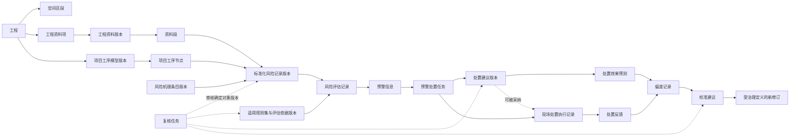

# RiskFlow 统一领域模型与业务对象生命周期

## 1. 目的与约束

本文定义 RiskFlow 完整产品及 MVP 共用的领域身份、版本、关系、状态和事实所有权。模型覆盖风险识别 RI-S1～RI-S6 与风险评估 RA-S1～RA-S7，并遵守以下原则：

- 专利固定中文术语、领域枚举和字段集合以项目级 `AGENTS.md` 为事实源；
- 一个业务事实只有一个拥有者，跨模块只能传递标识、精确版本引用和公开 DTO；
- LangGraph 拥有运行与暂停恢复状态，不拥有工程、风险、评估、预警或处置事实；
- 历史事实只追加、不覆盖；界面和 Agent 读取同一领域事实形成查询投影；
- “当前状态”是基于有效版本、业务时间、取代与作废关系计算的结果，不是最后更新的一行。

## 2. 领域主干



图中箭头表示业务引用或归属，不表示数据库外键设计。查询投影可以组合整条链路，但不得成为图中的新事实源。

## 3. 五类对象与统一规则

| 类别 | 典型对象 | 身份与版本规则 | 核心状态语义 |
|---|---|---|---|
| 工程上下文主数据 | 工程、空间区段 | 稳定身份；关键上下文变化形成新修订，历史事实保留原修订或快照 | 筹备 → 生效 → 结束 → 归档 |
| 受治理定义 | 工序模型、机理条目、指标体系、量化标准、结构化评分规则、权重、矩阵、阈值、措施库 | 条目独立修订，发布集合固定成员精确版本；发布后内容不可变 | 草稿 → 待审核 → 已发布 → 已停用；驳回或取消结束当前修订 |
| 不可变业务事实 | 资料版本、资料段、监测快照、风险记录版本、评估记录、预警信息、建议、反馈、偏差、决定 | 每次业务判断形成新事实；通过因果、取代或作废关系连接，禁止原地覆盖 | 无可变业务状态；当前效力由关系和决定推导 |
| 过程任务 | 接入任务、LangGraph 运行、Agent 任务、复核任务、预警处置任务、通知任务 | 稳定任务身份；当前状态可更新，每次状态转换形成不可变历史事件 | 按任务类型使用受控状态机 |
| 查询投影 | 风险态势、风险详情、待办队列、工序风险关联图谱视图 | 无独立业务身份；可删除和重建 | 不接受直接业务写入 |

项目级 OpenSpec 应为每个对象明确所属类别。不得让同一对象同时作为可编辑主记录、不可变事实和页面投影。

## 4. 身份与版本规则

### 4.1 通用规则

- 领域标识不可因名称、风险等级、区段名称或处理状态变化而改变；面向用户的编号与内部身份分离。
- 受治理对象使用“稳定对象身份 + 修订版本”；业务运行引用精确修订，不引用模糊的“最新版本”。
- 不可变事实每次产生独立身份；需要表达同一业务概念的演进时，使用因果、取代或作废关系。
- 唯一的结构化业务标识例外是专利规定的资料段标识：`资料ID-章节ID-资料段ID`。
- 任何跨模块版本引用都应形成显式版本引用值对象。标准化风险记录的七项专利内容字段保持不变，身份、精确版本、来源与审计信息放在记录信封或结果存储元数据中。

### 4.2 工程与空间区段

- 工程是权限、数据归属、配置选择和业务运行的顶层边界。
- 空间区段只隶属于一个工程，可以通过父区段形成层级；风险、资料和监测可以关联多个叶子或上级区段。
- 工程或区段的里程边界、施工工法、地层条件和工程阶段发生关键变化时形成新修订。
- 识别和评估事实引用当时使用的工程/区段修订或适用性元数据快照，不追随主数据后续变化。
- 工程结束后停止新增正常业务事实；归档后仅允许查询、审计和导出。

### 4.3 工程资料与监测

| 对象 | 稳定身份 | 版本/事实规则 |
|---|---|---|
| 工程资料项 | 表示用户认知中的同一份资料 | 聚合多个工程资料版本，不直接作为证据定位目标 |
| 工程资料版本 | 每次上传或重新解析产生新身份和新资料ID | 原始内容、元数据、解析配置及资料段集合冻结；旧版本保留 |
| 资料段 | 资料段标识 | 只属于一个资料版本；内容与相邻指针冻结，不跨版本复用身份 |
| 监测序列 | 同一工程、监测对象和指标的稳定身份 | 归集持续到达的数据批次，不作为一次评估的直接输入 |
| 监测批次 | 一次接入批次或时间窗口的不可变身份 | 按工程资料版本登记并生成可追溯资料段 |
| 监测快照 | 一次业务运行冻结的时间窗口身份 | 固定原始批次引用、清洗结果、短期斜率、加速度、频域主峰或异常评分 |

工程资料与空间区段是多对多关联。一份跨区间资料可以关联多个区段；证据引用最终落到确定资料版本中的资料段。

### 4.4 共享知识与项目版本

- 风险机理、规范条文、类比工程案例、指标定义和措施项默认属于共享知识作用域，可另外创建项目作用域条目。
- 条目具有稳定身份和独立修订；风险机理库、规范标准库、指标体系和措施库的发布版只保存成员精确版本引用。
- 站隧一体化施工工序模型具有可复用基线和项目版本。项目版本从基线初始化后独立审核发布，共享基线更新不会自动改变项目版本。
- 项目工序节点拥有项目内稳定的 `processNodeId`；标准化风险记录引用项目工序节点及其精确模型版本。
- 适用规则集是“已发布规则集合 + 适用性元数据快照”经一致性校验、适用性校验和审核后形成的项目级不可变发布版本。

## 5. 风险识别事实

### 5.1 模型输出候选

模型输出候选属于 LangGraph 运行工件，保存模型、提示模板、检索证据和原始结构化输出引用。它可以进入校验或复核，但不能用于风险评估、预警或界面当前风险统计。

### 5.2 标准化风险记录

- `riskRecordId` 是同一风险闭环的稳定身份，不另建 `RiskCase` 或同义风险事实。
- 标准化风险记录的内容版本通过 Schema、证据、规则和完整性校验后成立；低置信度、重大风险或校验失败时先进入复核。
- 同一风险补充证据、多来源合并或人工修正时创建新版本，并指向其取代的旧版本。
- 风险评估必须引用标准化风险记录的精确版本。后续 OpenSpec 需要在不改变七项专利内容字段的前提下，将精确版本引用加入记录信封与评估输入契约。
- 误判通过作废决定取消当前效力；原版本及既有评估、预警和处置事实继续保留。
- 用户界面的“统一风险详情”是标准化风险记录及其下游事实的查询投影，不具有新的风险身份。

### 5.3 外部风险事件

甲方直接提供的外部风险事件是独立的不可变输入事实。风险评估输入继续使用 `riskRecordId` / `externalRiskEventId` 可辨识联合类型，保证二选一且仅一个；外部事件不得伪装为标准化风险记录。

## 6. 评估、预警与处置闭环

### 6.1 风险评估记录

- 一次评估对一个标准化风险记录精确版本或一个外部风险事件执行。
- 评估冻结适用性元数据快照、适用规则集、指标实际值与规则、权重、风险矩阵、风险可接受阈值、监测预警阈值和监测快照的精确版本。
- 每次初评、监测更新重评、规则版本重评、矩阵版本重评或历史补算都生成新的风险评估记录。
- 风险评估记录不可修改；通过触发原因、上次评估引用和 LangGraph 运行标识形成因果链。
- “当前风险等级”由查询投影按有效输入和业务时点选择评估记录，不存回标准化风险记录。

### 6.2 预警信息与预警处置任务

- 每次 RA-S6 条件命中生成不可变预警信息，引用触发它的风险评估记录、触发类型、触发指标和证据。
- 预警信息与外部通知分离；通知失败不得删除或回滚预警事实。
- 预警处置任务按“工程 + 风险稳定身份 + 处置空间范围”归集尚未关闭期间的预警信息，不使用固定时间窗口；风险版本、触发类型、指标和等级不参与任务身份。
- 持续越限追加预警信息并关联现有任务，风险升级追加升级事件；任务关闭后再次越限形成新任务，并引用上一个任务作为历史上下文。
- 同一风险在不同处置空间范围分别建任务；跨范围协同通过任务关联表达，不合并各自事实归属。

### 6.3 处置建议、执行与反馈

- 处置建议 Agent 组合排序后的结果在三项约束校验全部通过前是处置建议候选工件，不能被采纳；任何人工决定都不能覆盖失败结果并把它改称处置建议。
- 处置建议是不可变建议版本，引用具体预警信息、措施库版本、适用性元数据、触发指标和三项约束校验结果。
- 预警处置任务承担建议采纳决定和现场执行进度；处置建议自身没有可变执行状态。同一任务可以保留多个历史建议版本，但任一时点至多有一个被采纳的建议版本。
- 处置效果预测是执行前形成的独立不可变事实，引用确定建议版本、处置前监测快照、预测时间范围、目标指标、冻结评分依据、预测策略版本与证据。
- 每次实际行动形成现场处置执行记录，来源可以是被采纳建议或现场独立决定；独立行动不得伪装成处置建议或自动进入措施库。
- 每次现场反馈引用预警处置任务、现场处置执行记录和处置后监测快照；采用建议时继续引用对应建议与处置效果预测。
- 偏差记录使用处置效果预测冻结的同一评分依据计算实际风险变化，再引用预测风险变化、实际风险变化和偏差阈值版本；新规则下的当前风险重评估不得混入该偏差。
- 预测不可用或缺少执行前预测时仍可记录反馈与当前风险重评估，但不得编造偏差或校准建议。
- 校准建议审核通过后，为受影响的受治理定义创建新修订并重新走发布流程；从新版本可以反向追溯至原偏差记录。

## 7. 过程任务状态

### 7.1 LangGraph 运行

```text
待运行 → 运行中 → 已完成
              ↘ 等待复核 → 运行中
              ↘ 可重试失败 → 运行中
              ↘ 终止失败 / 已取消
```

运行状态只表示编排进度。业务事实已入库后，即使后续节点失败也不得由检查点回滚或删除。

### 7.2 复核任务

```text
待领取 → 复核中 → 已决定
   └────────────→ 已取消
```

- 复核任务指向单一目标对象的精确版本，保存触发原因、所需权限和期限。
- 具体决定使用目标领域的类型化 Schema；统一任务外壳不得把不同领域决定压缩成模糊的通过/不通过文本。
- 要求修改或驳回时结束当前任务；提交方创建新版本和新任务，不在复核过程中直接编辑原对象。
- LangGraph 保存 `reviewTaskId` 并暂停，决定通过正式领域命令生效后恢复原运行。

### 7.3 接入、通知与其它过程任务

过程任务至少区分待处理、处理中、等待人工、成功、失败和取消。可重试失败必须保留已完成步骤和幂等键；通知任务的成功或失败不改变预警信息的成立状态。

### 7.4 Agent 任务

Agent 任务是统一过程对象，按触发方式区分内嵌任务和交互任务。任务固定发起者、工程、父运行、冻结基线、模型/提示模板、工具策略、资源预算和 Agent 增量 Schema 版本；会话可以持续存在，但每个任务必须有界。

```text
待运行 → 运行中 → 已完成
              ↘ 等待用户确认 → 运行中 / 已取消
              ↘ 可重试失败 → 运行中
              ↘ 终止失败 / 已取消
```

Agent 任务生成需要人工判断的候选后进入已完成，由独立复核任务承接人的决定。Agent 增量、候选、确定性校验和原始模型输入/输出是运行审计工件，不是风险、评估、预警、处置或复核事实。

## 8. 双时间与历史重建

- 不可变事实同时记录业务发生时间和系统记录时间。
- 受治理定义另外记录发布时间和生效区间；失效或重新启用只改变适用关系，不改发布内容。
- 补录历史监测数据可以触发注明“历史补算”的新评估记录，不伪装成当前实时评估。
- 当前投影按对象效力、业务时间、系统可见时间、取代和作废关系计算，不以更新时间排序代替领域选择规则。
- 历史查询支持指定业务时点和系统记录时点，重建当时可见的资料、知识、风险、评估与预警状态。

## 9. 事实所有权与跨模块引用

| 领域模块 | 拥有的事实 | 只能引用、不得复制的事实 |
|---|---|---|
| 工程数据 | 工程、空间区段、工程资料、资料段、监测批次与快照、外部风险事件接入事实 | 无 |
| 知识建模 | 工序模型、机理、规范、案例、指标、规则、适用规则集、矩阵、阈值、措施及发布集合 | 工程与适用性元数据快照 |
| 风险识别 | 模型输出候选、标准化风险记录版本、工序风险关联图谱的节点/边关联事实、多来源合并和综合置信度依据 | 资料段、项目工序节点、机理与检索证据版本 |
| 风险评估 | 指标评分明细与风险评估记录 | 风险记录版本或外部风险事件、监测快照、适用规则集及其它知识与配置版本 |
| 预警处置 | 预警信息、预警处置任务、处置建议、反馈、偏差和校准建议 | 风险评估记录、措施与阈值版本 |
| 复核审计 | 复核任务、类型化决定信封与审计事件 | 被复核对象的精确版本 |
| 应用查询 | 可重建查询投影 | 以上全部公开只读契约 |

LangGraph 图状态、API 响应、Agent 消息和页面状态均不是表中事实的所有者。

统一 Agent 任务模块拥有 Agent 任务、步骤、资源消耗和运行工件，但不拥有任何领域业务事实。各领域模块只接收任务类型化增量并返回确定性接受、拒绝和正式结果引用。

## 10. 审计模型

- 每个命令、状态转换、自动验收决定、人工决定、版本发布、作废和回滚都追加审计事件。
- 每个 Agent 任务另外保存冻结基线、模型/提示模板、工具策略、资源预算、工具行动、候选版本、Agent 增量、确定性接受/拒绝结果、错误和终态；原始渲染输入与模型响应作为不可变内容工件引用。
- 审计事件至少关联操作者或系统主体、动作、目标身份与精确版本、原因、业务发生时间、系统记录时间、LangGraph 运行与因果标识。
- 审计事件用于追责、差异解释和重放依据；领域实体与配置版本仍是业务事实源。
- 首期不采用完整事件溯源，不要求从审计事件重建全部业务状态。

## 11. 查询投影约束

以下对象只能作为投影存在：风险态势指标、统一风险详情、当前风险等级、待复核队列、待处置预警、工序风险关联图谱页面视图和 Agent 结构化答复。

投影必须满足：

1. 只引用领域公开查询契约；
2. 可以从事实与版本重新生成；
3. 不接受直接修改风险等级、处置状态或审核结果；
4. 缓存失效不影响业务事实；
5. 展示的每项结论都携带其事实标识、版本与证据入口。

## 12. MVP 适用范围

MVP 只运行单一工程，但实现上述身份、版本和状态语义，不使用“因为只有一个项目”而省略工程标识或作用域。MVP 可以缩小资料、知识、规则和监测规模；以下能力不可裁剪：

- 工程资料项、不可变版本与资料段追溯；
- 项目工序模型版本和项目工序节点身份；
- 标准化风险记录稳定身份及精确版本；
- 不可变风险评估记录、预警信息和处置反馈链；
- 复核任务、作废决定、校准建议审核和审计事件；
- 五类必经内嵌 Agent 任务及交互 Agent 任务的统一身份、状态、预算、增量和审计；
- 双时间记录及至少对固定验收样例的历史重放。

## 13. 后续 OpenSpec 要求

生产实现前，相关 change 需要明确：

- 各稳定身份、版本引用和记录信封的 Zod Schema；
- 标准化风险记录七项内容字段与版本信封的组合方式；
- 工程资料版本、资料段、监测批次和监测快照的契约；
- 发布集合、适用规则集和评估依据的精确版本引用；
- 五类对象的状态机、命令、决定和审计事件；
- Agent 任务信封、状态、工具/预算版本、任务类型化增量、候选与运行审计工件；
- 查询投影的只读边界与重建规则。

持久化产品、内部 ID 算法、数据库表和索引由后续存储票据确定，不属于本领域决议。
