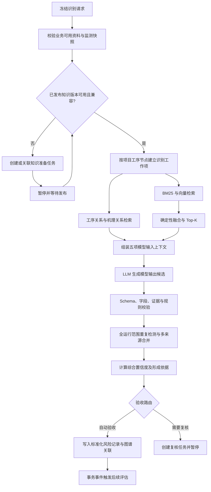

# RiskFlow 风险识别工作流与人工复核契约

> 状态：Wayfinder 已确认的规划基线；本文不替代后续 OpenSpec 正式规格。

## 1. 目标与边界

顶层 `riskFlowGraph` 负责把用户的一次识别请求准备为冻结输入，`identificationGraph` 负责把该冻结输入编排为可恢复、可重放、可审计的识别运行，最终产生标准化风险记录、工序风险关联图谱关联事实、综合置信度依据或显式人工复核任务。

图只保存编排状态和精确版本引用。工程资料、知识发布版本、模型输出候选、标准化风险记录、复核任务和审计事件仍由各自领域模块拥有。

## 2. 已确认：识别运行只消费已发布知识版本

普通识别运行只能使用已审核发布的项目站隧一体化施工工序模型和风险机理库精确版本。不得在一次风险推理中临时抽取、修改并直接使用未审核的工序或机理知识。

若所需版本缺失，或现有发布版本与本次冻结输入不兼容：

1. `identificationGraph` 创建或关联独立的知识准备任务；
2. 运行保存任务标识、所需发布物与触发原因，然后进入等待状态；
3. 知识准备流程按受治理定义的修订、校验、复核和发布规则工作；
4. 发布完成后，原运行以精确版本引用恢复并重新执行前置校验；
5. 被取代、停用或仍不兼容的版本不能因恢复而被静默采用。

RI-S3 与 RI-S4 通过知识准备流程、发布版本、运行引用和审计事件保持可追踪对应物。普通识别运行中的“工序模型准备”和“机理上下文准备”只校验、选择并冻结版本，不重新拥有知识构建逻辑。

## 3. 初步流程骨架



候选修订、错误分类与最终状态 DTO 在后续章节中展开。

## 4. 已确认：全局合并后按合并组独立验收

一次运行先完成全部工序节点工作项的候选收集，再在全运行范围执行重复检测与多来源合并。不得在尚未看见其它候选时按工序节点提前写入标准化风险记录。

重复检测完成后，每个合并组成为最小验收单元：

- 无争议且通过全部校验的合并组可以先验收入库，并产生后续评估事务事件；
- 需要人工判断的合并组各自形成一个指向精确候选版本和校验快照的复核任务；
- 同一合并组中的候选共同决定一个标准化风险记录版本，不得部分验收；
- 不同合并组相互独立，一个争议组不阻塞其它合格组；
- 运行只要仍有未决定的复核任务，就保持“等待复核”；已验收入库的业务事实不因暂停、拒绝、取消或后续失败而回滚。

运行结果汇总至少区分已验收、等待复核、已拒绝、终止失败和已跳过的合并组，并保存各组合并依据、验收决定和业务结果引用。

## 5. 已继承且不重复决策的约束

- 资料解析与 Agent 主导清洗先形成业务可用、不可变的工程资料版本或监测快照；识别运行只冻结引用，不在图中直接查询外部来源。
- 模型输出候选是运行工件，不能直接进入评估、预警或风险统计。
- 标准化风险记录保持七项专利内容字段，身份、版本、知识和运行引用放在记录信封或结果存储元数据中。
- BM25 与向量检索独立打分，融合策略与 Top-K 使用冻结的版本化配置。
- 检查点只恢复编排；业务事实、复核任务和审计事件必须可靠入库。
- 所有外部写入使用运行标识与业务幂等键，恢复或重试不得产生重复记录。

## 6. 已确认：一站式修正并通过

人工复核界面提供一个面向业务的复合动作“修正并通过”。复核人不需要理解或手工管理候选版本、重新送审和图恢复步骤。

该动作允许复核人在一个页面中：

- 修正标准化风险记录契约内的候选字段；
- 从已有权限范围内补选或移除证据引用；
- 调整重复候选的合并或分立关系；
- 填写必要的判断依据。

提交后由同一深模块接口完成：

1. 校验复核权限、任务状态和目标精确版本，拒绝基于已被取代对象的陈旧提交；
2. 创建新的不可变候选版本，记录人工来源、原候选引用、字段差异、证据差异、操作者与时间；
3. 重新执行 Schema、领域枚举、证据可达性、合并约束、规则一致性和 RI-S61 完整性校验；
4. 校验通过时，经与自动验收相同的入库接口生成标准化风险记录及验收决定，关闭当前复核任务并恢复原运行；
5. 校验失败时保留本次候选版本和结构化失败原因，当前任务继续处于复核中，界面直接展示需要修正的字段，不创建新的复核任务。

复核人也可以不修改而原样通过，或拒绝该合并组。需要改变原始资料、监测快照、项目工序模型、风险机理条目或其它已发布知识时，不允许在候选页伪造修正；系统把任务路由到相应上游流程，待新版本发布后恢复识别。

## 7. 已确认：默认自动验收与最少打扰

识别结果默认走自动验收。只有存在需要业务判断的不确定性或命中明确治理策略时，才打断用户并创建复核任务。

### 进入人工复核

- 经过限定次数的自动结构修复后，仍缺少风险源、风险因素、风险事件、风险要素关系、证据定位信息或模型置信度等语义字段；
- 模型输出包含标准字段契约之外的字段。该情况按项目硬约束直接复核，不静默丢弃；
- 证据引用不存在、无权限、无法回溯到资料段，或证据与候选结论存在确定性冲突；
- 综合置信度未达到本次运行冻结的策略版本阈值；
- 重复检测无法可靠确定候选应合并还是保持分立；
- 规则一致性校验或可用的仿真/试验约束发生冲突；
- 命中项目发布的强制复核策略，例如指定工序节点、机理类型或其它甲方审核条件。

识别阶段尚未形成 P/C 与风险等级，因此不使用模型主观判断的“重大风险”作为硬编码复核条件。若甲方要求某类高影响候选必须复核，应由版本化强制复核策略表达并进入运行快照。

### 不进入人工复核

- 模型服务超时、限流、响应中断；
- BM25、向量或关系检索设施暂时不可用；
- 检查点、事务提交或其它基础设施发生瞬时错误；
- 取消请求或失去运行租约。

这些技术错误按冻结的重试策略处理。重试耗尽后，相关工作项和运行进入可重试失败或终止失败，并给出运维诊断；不得创建要求复核人代替系统修故障的业务复核任务。

未命中上述条件且通过所有硬约束的合并组自动验收入库。每次自动验收仍生成验收决定与审计事件，记录使用的策略、校验结果和责任主体。

## 8. 已确认：批量处理无修改决定

复核队列允许多选任务后批量执行“原样通过”或“拒绝”。提交前必须展示工程、任务数量、触发原因分布、涉及的工序与风险事件，以及将产生的业务结果；复核人一次确认即可提交。

批量动作只是应用层便利接口，不把多个复核任务合并成一个领域对象。后台对每个任务独立执行：

1. 权限与工程作用域校验；
2. 任务仍处于可决定状态且目标版本未被取代；
3. 原样通过时重新确认其验收前置条件；
4. 写入独立的类型化决定和审计事件；
5. 验收入库或拒绝对应合并组，并更新原运行的汇总状态。

单项失败不回滚已成功的其它项。响应按任务返回成功、已过期、权限不足、校验失败或并发冲突，界面只要求用户继续处理失败项。

字段修正、证据补选、合并或拆分仍使用单项“一次修正并通过”，不提供跨任务批量改写。

## 9. 已确认：用户一步启动，内部按模块分层

工程风险管理员只需选择资料范围并执行一次“启动识别”。顶层 `riskFlowGraph` 负责把资料准备和风险识别组合成同一条可观察运行：

1. 工程数据模块登记或读取指定工程资料版本；
2. 对尚未形成业务可用结果的输入执行解析、Agent 主导清洗、资料段登记和结构硬约束校验；
3. 隔离失败资料段，由 Agent 判断剩余覆盖是否足以继续，并保存排除范围与依据；
4. 生成不可变的识别准备快照，冻结资料版本、包含/排除资料段、监测快照及数据处理版本；
5. 知识就绪检查补齐精确知识和运行策略版本后，生成最终识别输入快照；
6. `identificationGraph` 只接收最终快照，开始工序工作项、检索、推理、合并与验收。

用户不必先进入资料模块逐项完成准备。内部仍保持所有权：工程数据模块拥有解析和清洗成果，风险识别模块不得通过图节点直接读取文件、外部数据库、API 或实时流。

RI-S1、RI-S2 的执行记录、资料段失败回溯和输入快照与后续识别运行共用因果运行标识，因此从一次用户操作可以追踪完整专利链路。使用已经业务可用的输入时，顶层流程只执行幂等检查和冻结引用，不重复解析。

## 10. 已确认：人工修正不伪造模型置信度

`modelConfidence` 始终表示原模型输出候选的置信度，由模型产生并保持只读。复核人不能手工修改该值，系统也不在“修正并通过”时额外调用模型重新打分。

人工修正后的候选版本必须保留：

- 原模型输出候选及其精确版本；
- 原始 `modelConfidence`；
- 人工修正字段、证据和合并关系的前后差异；
- 复核人、判断依据、任务和决定；
- 修正后重新执行的规则、证据、仿真和多来源合并校验结果。

综合置信度仍按本次运行冻结的策略，以原模型置信度、修正后的规则一致性结果、仿真约束结果和多来源合并情况重新计算并保存形成依据。人工决定作为审计和验收依据单独展示，不暗中改成模型分数或额外置信度因子。

界面并列显示“原模型置信度”和“已人工修正通过”。若原候选缺少 `modelConfidence`，人工不得自行补分；系统只能按修复策略重新取得模型输出，或由复核人拒绝该候选。

## 11. 版本化输入与图状态契约

### 11.1 识别准备快照

资料处理完成后先创建 `IdentificationPreparationSnapshotV1`，冻结项目与区段修订、资料版本、包含/排除资料段、监测快照、数据处理工具与模型版本、覆盖判断及其审计引用。它只用于等待知识依赖和生成最终输入，不能直接进入风险推理。

### 11.2 识别输入快照

知识就绪检查完成后，基于准备快照创建 `IdentificationInputSnapshotV1`。它是一次识别运行的不可变输入事实，至少冻结：

```text
schemaVersion
projectId + projectRevisionRef
spatialSegmentRevisionRefs[]
sourceVersionRefs[]
includedSourceSegmentIds[]
excludedSourceSegments[] { sourceSegmentId, reasonCode, decisionRef }
monitoringSnapshotRef?
processModelReleaseRef
riskMechanismReleaseRef
evidenceBaseReleaseRefs { mechanism, standards, analogousCases }
retrievalPolicyRef
retrievalReviewAgentPolicyRef
repairPolicyRef
confidencePolicyRef
forcedReviewPolicyRef
retryPolicyRef
modelDeploymentRef
promptTemplateRef
createdBy + createdAt
```

输入快照只引用精确版本，不保存“当前最新版”。来源、知识或策略后续更新不会改变已有快照；需要使用新版本时创建新运行。

### 11.3 `IdentificationGraphStateV1`

图状态保持小而稳定，只保存编排所需的标识和汇总：

```text
schemaVersion
graphVersion
parentRiskFlowRunId
runId
threadId
triggerType + triggerReason
actorRef
preparationSnapshotRef
inputSnapshotRef?
status
stage
workPlanRef?
candidateSetRef?
agentTaskRefs[]
mergePlanRef?
acceptedRiskRecordRefs[]
reviewTaskRefs[]
rejectedGroupRefs[]
failedWorkItemRefs[]
lastRouteDecisionRef?
lastErrorRef?
resultRef?
```

状态不得保存原始文档、完整 JSON-LD、完整检索片段、模型内部思维链、完整候选正文或标准化风险记录副本。这些内容由所属领域模块以工件或事实保存，图状态只引用其标识。

### 11.4 运行与阶段状态

运行状态沿用统一过程任务语义：

```text
待运行 → 运行中 → 已完成
              ↘ 等待复核 → 运行中
              ↘ 可重试失败 → 运行中
              ↘ 终止失败
              ↘ 已取消
```

`stage` 用来描述当前工作位置，不扩张顶层状态枚举：资料准备、知识就绪、工作项规划、检索、检索审阅、推理、校验、合并、验收、结果汇总。

每个工序工作项独立记录待处理、处理中、等待合并、可重试失败、终止失败、已取消和已完成；每个合并组独立记录待验收、等待复核、已验收、已拒绝、已跳过或失败。顶层状态由这些子状态确定性归纳，不由节点随意赋值。

## 12. `identificationGraph` 阶段契约

### I0 资料准备与输入冻结（RI-S1、RI-S2，顶层组合阶段）

- 接收一次用户“启动识别”命令及业务幂等键；
- 调用工程数据模块完成登记、解析、Agent 主导清洗、资料段校验和必要重处理；
- 只将业务可用资料段写入包含清单，明确记录排除范围与覆盖判断；
- 创建不可变识别准备快照；
- 没有可用资料段、权限不完整或覆盖不足时，不进入识别子图，返回结构化业务阻断。

### I1 知识就绪检查（RI-S3、RI-S4）

- 校验项目工序模型、风险机理库和检索证据库发布版本存在、已审核、未停用且与工程作用域兼容；
- 版本缺失或不兼容时创建或关联知识准备任务，保存依赖后暂停；
- 恢复时重新校验精确版本，不静默切换到其它版本；
- 通过后把准备快照、精确知识版本和全部运行策略合成为最终识别输入快照，再进入 `identificationGraph`。

### I2 工序工作项规划（RI-S31～RI-S34）

- 从已发布项目工序模型读取本次范围内的工序节点、装备、构件、状态参数及三类依赖关系；
- 以项目 `processNodeId` 建立稳定工作项，并绑定相关资料段和监测快照；
- 保存计划覆盖、被排除节点及原因；
- 至少核对五个专利必含工序节点在项目模型中的覆盖，不在本阶段临时补造节点。

### I3 混合检索与关系检索（RI-S52～RI-S55）

- BM25 与向量检索基于同一检索证据库发布内容，但使用独立索引和打分；
- 按冻结策略确定性融合、排序并截取 Top-K，形成基线候选集，保存原始排名、分数、融合参数和候选证据引用；
- 同时沿工序依赖与机理关联取得当前节点、前后节点、依赖关系及机理条目；
- 对每个工序工作项执行一次必须的“检索审阅”Agent 任务。任务只读取冻结的工序上下文、基线候选集和已发布检索证据库，只能调用任务专属的证据查询与关系查询工具，在硬预算内返回保留、排除、重排和补充证据引用等类型化检索增量；
- 独立确定性校验器检查增量 Schema、资料权限、证据所属发布版本、引用可达性和数量上限，再由识别模块应用增量形成最终检索工件。权限、来源版本或冲突问题不得交给同一任务循环绕过；
- Agent 任务失败时只按冻结策略和预算重试。失败或预算耗尽不得跳过审阅并直接使用基线候选进入推理；需要更换模型、工具、预算或策略时创建新运行；
- 任一必需索引不可用时按技术错误重试，不降级为单索引并假装完整检索。

### I4 上下文组装与 LLM 推理（RI-S51、RI-S56、RI-S57）

- 模型输入上下文必须同时包含工序节点描述、状态参数描述、受力依赖关系、风险机理条目和检索证据；
- 提示模板明确当前 `processNodeId`、五项约束上下文和统一输出字段；
- 上下文保存版本引用、内容哈希和裁剪依据，不保存模型内部思维链；
- 模型输出保存受权限保护的原始响应引用及结构化模型输出候选；
- 本阶段是受固定输入输出契约约束的专用 LLM 节点，不创建第二个 Agent 对候选做同模型自我审阅；后续只执行确定性校验、明确的结构修复和人工复核路由；
- 模型名称、量化文件和 llama.cpp 细节由模型部署版本封装，不进入业务字段。

### I5 结构修复与确定性校验（RI-S58、RI-S59、RI-S61）

- 使用版本化别名表统一已知字段名称，将 `processNodeId` 从当前工作项确定性绑定到候选；
- 格式、类型或可机械判断的缺失可按修复策略处理；确需模型补齐的语义字段，只能针对校验器明确指出的缺失项在相同冻结上下文内有界补齐，不重新评价整份候选，也不构成同模型自我审阅；
- 契约外字段直接标记复核，不静默删除；
- 校验 Schema、领域枚举、RI-S61 必填字段、证据可达性和资料权限；
- 执行规则一致性校验及可用的仿真/试验约束，保存每项结构化结果；
- 修复策略耗尽后仍不合格的候选保留为不可变工件，等待后续合并与复核路由。

### I6 全运行重复检测与多来源合并（RI-S62、RI-S63）

- 等待所有可继续的工序工作项到达合并屏障；
- 当同一风险在至少两个工序节点或至少两个资料来源出现时，按工序节点一致性、事件表达相似性和证据定位相似性形成合并提案；
- 没有重复识别时显式记录跳过，不生成空合并结果；
- 合并关系明确时形成合并组；关系不明确时形成合并组复核任务；
- 任何标准化风险记录均不得在该全局阶段完成前入库。

### I7 综合置信度与验收路由（RI-S64）

- 使用冻结策略计算综合置信度；输入为模型置信度、规则一致性结果、仿真约束结果和多来源合并情况；
- 保存每个输入、缺失处理、权重或融合规则、输出值及策略版本；
- 依照第 7 节的最少打扰策略判断自动验收或人工复核；
- 路由是确定性决定工件，重复执行必须返回相同结果。

### I8 业务入库与后续事件（RI-S62、RI-S65）

每个通过验收的合并组通过同一风险识别模块接口原子写入或可靠关联：

- 标准化风险记录身份与不可变版本；
- 风险机理条目、资料来源、项目工序节点和证据定位引用；
- 工序风险关联图谱的业务关联事实；
- 综合置信度及形成依据；
- 自动或人工验收决定、版本信息和审计事件；
- “标准化风险记录已验收入库”事务事件。

物理图索引可以作为可重建投影异步更新，但关联事实和待发布事务事件必须与风险记录可靠提交。评估消费方只引用 `riskRecordId` 及精确版本，不能复制风险事件定义。

### I9 结果汇总

- 汇总所有工序工作项和合并组的终态；
- 仍有复核任务时保持等待复核；
- 存在未恢复的技术失败时不得显示为完整成功；
- 所有组已验收、拒绝或按明确策略跳过，且无未恢复失败时，运行进入已完成；
- 生成覆盖范围、排除项、接受/拒绝/待复核/失败数量及全部业务结果引用。

## 13. 路由矩阵

| 情况 | 路由 | 是否创建复核任务 | 业务事实处理 |
|---|---|---:|---|
| 输入尚未处理 | 顶层调用工程数据模块 | 否 | 完成后冻结快照 |
| 无可用资料段或权限不完整 | 业务阻断 | 仅在需要业务判断时 | 不进入识别 |
| 已发布知识缺失或不兼容 | 知识准备并暂停 | 知识发布需要审核时是 | 发布后恢复 |
| 检索或模型瞬时故障 | 自动重试 | 否 | 不生成空候选 |
| 检索审阅 Agent 失败或预算耗尽 | 按冻结策略重试，耗尽后失败 | 否 | 不跳过 Agent 使用基线候选继续 |
| 契约外字段 | 合并后复核 | 是 | 不静默裁剪 |
| 缺失语义字段且修复耗尽 | 合并后复核 | 是 | 保留候选与失败原因 |
| 证据无效或冲突 | 合并后复核 | 是 | 不自动验收 |
| 不存在重复 | 显式跳过合并 | 否 | 单候选形成独立组 |
| 合并关系不明确 | 合并组复核 | 是 | 不部分验收 |
| 综合置信度达标且无强制复核 | 自动验收 | 否 | 可靠入库并发事件 |
| 综合置信度未达阈值或策略命中 | 合并组复核 | 是 | 其它组合格后可先入库 |
| 人工修正通过校验 | 修正并验收 | 复用当前任务 | 新候选版本直接入库 |
| 人工拒绝 | 结束该合并组 | 关闭当前任务 | 不创建风险记录 |

## 14. 错误、重试与取消契约

### 14.1 结构化错误

每个错误至少记录：错误码、类别、阶段、工作项或合并组、是否可重试、当前尝试次数、重试策略版本、最早重试时间、诊断引用、发生时间和因果运行标识。错误文案只用于展示，不作为程序分支或稳定测试契约。

错误分为：

1. **瞬时技术错误**：模型超时、索引暂不可用、网络中断、租约丢失、事务冲突等；按策略自动重试。
2. **可恢复业务阻断**：输入未就绪、知识待发布、权限待补充或上游版本需修订；转到明确上游任务并等待，不盲目重试。
3. **业务复核条件**：字段、证据、合并、置信度或约束需要人判断；创建复核任务。
4. **终止错误**：冻结输入损坏、版本被安全撤销、Schema/图版本不受支持或其它在原运行中无法合法恢复的错误；终止该运行。

### 14.2 重试

- 最大次数、退避、超时和可重试错误码由本次运行冻结的策略决定；
- 检索审阅 Agent 还受模型调用、工具调用、上下文、输出、候选数量、修复轮次、墙钟时间和并发上限约束，任何一项都不能由任务自行扩大；
- 重试在原工作项和原运行中执行，使用相同输入与业务幂等键；
- 自动次数耗尽后进入可重试失败，供运维修复后显式恢复；
- 不得静默切换模型、提示模板、知识版本、索引策略或输入资料；需要更换任何版本时创建新运行；
- 已完成的检索、模型输出或业务写入有可验证工件时，恢复直接复用，不重复外部副作用。

### 14.3 取消

- 取消是协作式的：停止尚未开始的工作项，并请求模型网关终止可取消调用；
- 已可靠入库的标准化风险记录、复核决定和审计事件不回滚；
- 被取消运行生成结果汇总，明确已完成、未开始和中断范围；
- 已取消运行不恢复。用户重新启动时创建新运行和新输入快照，旧运行保留用于审计。

## 15. 幂等、恢复、重放与重新运行

### 幂等

- 用户启动命令携带业务幂等键，重复提交返回同一顶层运行；
- 工序工作项、模型调用工件、合并组、验收入库和事务事件分别使用稳定业务键；
- LangGraph 节点从头重跑时先查询既有工件或事实，再决定是否继续；
- 同一合并组的自动验收、人工验收和批量验收共用一个入库接口，不能产生重复风险版本。

### 恢复

恢复继续原 `threadId`、原输入快照和原版本集合。已完成节点不重新调用模型或重复写业务事实；等待复核时依据类型化决定继续。若目标版本已被取代，恢复必须重新路由而不能基于陈旧对象验收。

### 重放与重新运行

- **审计重放**：读取已保存检索、模型候选、校验、合并和策略工件，重新执行确定性路由并核对结果，不重新调用模型。
- **重新运行**：需要新模型输出、新资料、新知识或新策略时创建独立运行，引用原运行作为触发原因并生成新的业务事实版本。

二者在界面和接口中使用不同命令，禁止把一次新推理伪装成旧运行重放。

## 16. 人工复核契约汇总

每个复核任务指向一个合并组及其候选、校验和置信度快照，保持“待领取 → 复核中 → 已决定 / 已取消”。识别复核支持以下面向用户的动作：

- 原样通过；
- 修正并通过；
- 确认合并；
- 保持分立；
- 拒绝候选或合并组；
- 退回原始资料或知识治理流程。

“修正并通过”内部创建新候选版本并重校验，但对用户是一项操作；原样通过和拒绝支持批量执行。所有决定保存结构化原因、目标精确版本、操作者和时间。复核页面关闭、浏览器离开或 Worker 重启不会丢失任务。

## 17. 业务结果契约

### 17.1 标准化风险记录信封

标准化风险记录内容仍严格保持七项字段：

```text
processNodeId
riskSource
riskFactor
riskEvent
riskElementRelations
evidenceLocator
modelConfidence
```

身份、版本和追溯信息放在记录信封或结果存储元数据中，包括 `riskRecordId`、记录版本、项目工序模型版本、风险机理条目版本、资料来源、识别输入快照、运行、模型/提示模板、验收决定、综合置信度形成依据、取代/作废关系及审计引用。不得向七项内容字段中夹带这些元数据。

### 17.2 `IdentificationRunResultV1`

运行结果至少包含：

```text
runId + parentRiskFlowRunId
status
inputSnapshotRef
processNodeCoverage { planned, completed, excluded, failed }
sourceCoverage { includedSegments, excludedSegments }
acceptedRiskRecordRefs[]
pendingReviewTaskRefs[]
rejectedGroupRefs[]
skippedMergeGroupRefs[]
failedWorkItemRefs[]
associationGraphChangeRef?
assessmentEventRefs[]
auditTrailRef
startedAt + finishedAt?
```

运行结果是过程汇总，不复制标准化风险记录内容，也不作为当前风险查询的事实源。

## 18. 审计与权限

一次识别运行至少记录：

- 启动者、工程与权限上下文、业务幂等键和触发原因；
- 顶层图、识别子图和节点版本；
- 输入快照、资料处理、包含/排除范围及 Agent 清洗依据；
- 工序模型、风险机理库、证据库和全部策略版本；
- BM25、向量和关系检索结果引用、融合分数与 Top-K；
- 检索审阅 Agent 任务的可重建输入、原始模型输出、任务/模型/提示模板/工具/预算/增量/校验器版本、工具调用、增量应用结果与资源消耗；
- 模型部署、提示模板、上下文哈希、原始响应和候选版本；
- 自动修复、每项确定性校验、合并依据、置信度形成依据与路由决定；
- 自动验收、人工决定、批量动作的逐项结果；
- 每次错误、重试、暂停、恢复、取消和业务入库；
- 业务发生时间、系统记录时间和因果运行标识。

证据与原文读取继承资料权限。复核人可以看见完成判断所需的证据摘要和定位，但无权读取的原文不得通过模型输出、审计导出或批量复核泄露。

## 19. 专利追踪

| 专利步骤 | 工作流对应物 | 主要持久化结果 |
|---|---|---|
| RI-S1 | I0 资料准备 | 工程资料版本、元数据、资料段、权限与审计 |
| RI-S2 | I0 解析清洗与输入冻结 | JSON-LD、结构信息、监测摘要、失败回溯、输入快照 |
| RI-S3 | I1 知识就绪、I2 工序工作项 | 已发布项目工序模型、节点与依赖精确引用 |
| RI-S4 | I1 知识就绪 | 已发布风险机理库、关联与证据精确引用 |
| RI-S51～S57 | I3、I4 | 检索工件、五项上下文、模型输出候选 |
| RI-S58～S59 | I5 | 修复、Schema、规则与仿真约束结果 |
| RI-S61 | I5、I7 | 完整性结果与验收路由 |
| RI-S62 | I8 | 标准化风险记录与工序风险关联事实 |
| RI-S63 | I6 | 多来源合并或显式跳过结果 |
| RI-S64 | I7 | 综合置信度及形成依据 |
| RI-S65 | I8、I9 | 完整结果、版本、审计与评估事件 |

## 20. MVP 落地边界与验证点

MVP 必须真实具备：一次启动完成资料准备与识别、已发布知识版本冻结、BM25 与向量双索引、关系检索、检索审阅 Agent、私有模型推理、结构修复、全局合并、综合置信度、自动验收、异步人工复核、一站式修正、批量无修改决定、暂停恢复、审计重放和后续评估事件。不得使用预写模型输出或 Mock 作为验收回退。

MVP 可以限制为单一工程、单 Worker、受限资料格式与知识规模，但下列行为必须验证：

1. 同一启动幂等键不产生重复运行；
2. 检查点恢复不重复调用已完成模型步骤或重复入库；
3. 一个合并组等待复核时，其它合格组可先入库；
4. 修正并通过只需一次用户操作，原候选与差异可追溯；
5. 批量决定逐项审计，部分失败不回滚成功项；
6. 技术失败不创建业务复核任务；
7. 双索引缺一时不静默降级；
8. 检索审阅 Agent 失败或预算耗尽时不跳过为基线检索，也不切换策略继续；
9. 取消和终止失败不删除已入库事实；
10. 审计重放可以解释当次基线检索、Agent 增量、最终证据、合并、置信度和路由；
11. 每个验收记录都能沿资料段、工序节点、机理条目和运行版本完整追溯。

## 21. 后续票据接口

- “确定知识库、混合检索与图谱查询策略”负责确定 I3、I6 的物理索引、融合与图查询策略，不改变本票的输入输出和显式跳过语义。
- “确定模型、检索与规则质量评测策略”负责给出修复、置信度、合并和强制复核策略的验证方法与发布门槛。
- “设计完整产品界面与交互规格”据此实现一步启动、异步进度、复核队列、一站式修正和批量决定，不新增第二套流程状态。
- “定义 Agent-native 横切运行与治理契约”统一 I0 清洗和 I3 检索审阅的任务状态、专属工具、硬预算、类型化增量、校验、失败与审计；本流程不新增 RI-S57 后的同模型 Agent 自我审阅。
- “确定 MVP 测试、验收与交付证据”把第 20 节转为可观察验收项。
- 最终 OpenSpec 路线需要把输入快照、图状态、工作项、合并组、错误、复核决定、运行结果和标准化风险记录信封落实为版本化 Zod Schema 与领域接口。
