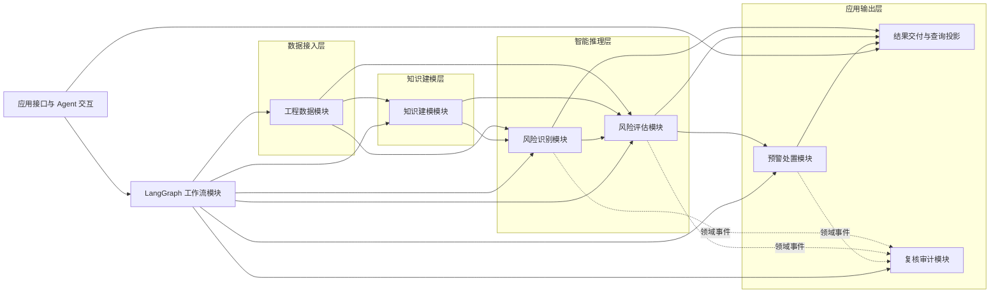
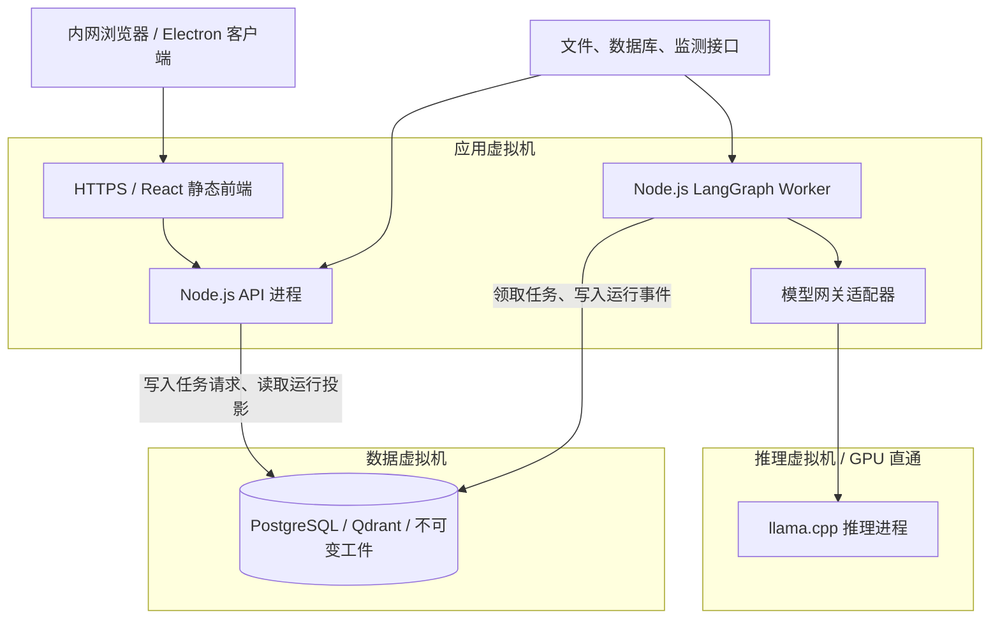
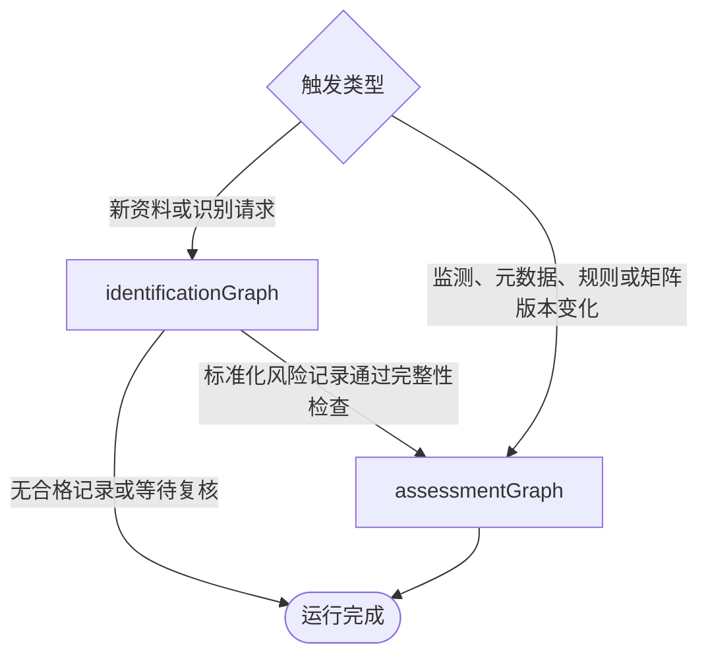

# RiskFlow 识别与评估一体化宏观架构

> 状态：规划基线。本文只确定系统边界和依赖规则，不替代后续 OpenSpec 中的接口、数据模型与部署规格。

## 1. 架构结论

RiskFlow 首期采用 TypeScript 模块化单体。完整 React 业务界面统一由 `apps/web` 提供，Electron 桌面客户端加载其内网 HTTPS 入口，电脑浏览器访问同一界面。Node.js API 与 LangGraph Worker 在服务器独立运行并共享领域模块与 Zod 契约；`llama.cpp` 以独立推理进程部署，通过模型网关接入。识别、评估、预警等业务能力不拆成微服务。

桌面与后续多终端的具体边界见[桌面客户端与多终端架构](desktop-client-architecture.md)。该目标由 C37 实施；当前代码仍为三个应用、三个共享包，尚无 Electron 客户端。

四层架构负责约束依赖方向和保持双专利步骤可追踪，六个领域模块负责业务事实的所有权。`@langchain/langgraph` 是唯一主流程编排核心，负责运行、暂停、恢复和路由，不拥有风险事实，也不代替业务数据库。

## 2. 逻辑架构



图中实线表示公开接口调用，虚线表示已入库事实产生的事务事件。结果交付与查询投影只组合各领域模块已经确认的事实，不是第七个领域模块。领域模块不反向依赖 LangGraph、API 或界面。

### 四层与领域模块的关系

| 领域模块 | 所在主层 | 拥有的业务事实 | 不负责的事情 |
|---|---|---|---|
| 工程数据 | 数据接入层 | 项目与区段上下文、工程资料版本、资料段、监测摘要、适用性元数据快照 | 风险判断、规则选择、P/C 评分 |
| 知识建模 | 知识建模层 | 站隧一体化施工工序模型、风险机理库、检索证据库、指标体系、结构化评分规则、适用规则集、风险矩阵、措施库及其版本 | 编排图状态、最终风险评分、界面投影 |
| 风险识别 | 智能推理层 | 标准化风险记录、综合置信度及其形成依据、工序风险关联图谱 | 修改工程资料、直接给出 P/C 或风险等级 |
| 风险评估 | 智能推理层 | 指标取值结果、P/C 计算结果、风险矩阵映射、风险评估记录 | 改写识别事实、自动发布规则版本 |
| 预警处置 | 应用输出层 | 预警信息、处置建议、处置反馈、偏差记录、校准建议 | 绕过风险评估记录触发预警、自动覆盖生效规则 |
| 复核审计 | 应用输出层 | 人工复核任务、审核决定、审计事件、追溯视图 | 代替原领域模块保存业务实体、修改历史记录 |

Agent 任务、Agent 交互和 LangGraph 工作流是应用模块。统一 Agent 任务模块承接内嵌与交互任务的有界模型/工具运行，业务模块提供任务类型化工具、增量和确定性校验；LangGraph 只编排任务引用与路由。三者都不维护第二套风险记录或评估结论。

## 3. 部署拓扑



### 部署单元

1. `web`：React 前端静态资源，只通过 API 访问业务能力。
2. `api`：鉴权、项目上下文、命令提交、查询、Agent 会话和 SSE/流式运行事件出口。
3. `worker`：执行 `riskFlowGraph` 及子图。它与 API 使用相同的 TypeScript 领域包，但耗时推理、解析和重评估不占用 API 进程。
4. `llama-server`：`llama.cpp` 推理进程。最低硬件验收候选为 Qwen3.8-27B `Q4_K_M`、单槽、32K 总上下文、F16 KV、关闭 MTP；模型名称和量化文件不进入业务代码。
5. 数据基础设施：PostgreSQL 保存业务记录、LangGraph 检查点和事务事件，C04 工件目录保存不可变文件，Qdrant 与 BM25 是可重建检索投影，不另设图库。
6. `desktop`：Electron 主进程与必要本机能力，仅加载应用 VM 的 HTTPS 页面，不运行领域服务或持有服务器凭据。

三台 VM 位于同一台物理服务器，只提供资源与进程隔离。部署不依赖公网；同机副本用于逻辑回退，不承诺高可用、独立备份或生产级 RPO/RTO。C37 使用 systemd 管理进程与固定数据服务容器，Caddy 2.11.7 提供同源 HTTPS。C04 工件留在数据 VM 本地存储，应用 VM 使用有界、双向 TLS 的 put/open 流接缝；维护核对在数据 VM 本地执行，引用检查仍在原 PostgreSQL 事务内。Docker Compose 不是既定部署前提。

开发环境可以合并 API 与 Worker 进程；生产部署保留分进程能力。两者属于同一个业务系统，不通过内部 REST 互相包装领域调用。

## 4. LangGraph 父子图

### 4.1 运行模型

每次业务触发创建一个有明确起止的运行。系统不维护永久驻留、无限等待的 Agent 图。



顶层 `riskFlowGraph` 只做入口选择、子图组合、运行级错误处理和人工复核路由：

- 新资料进入：`identificationGraph → assessmentGraph`；
- 已有风险的监测摘要或适用性元数据变化：只运行 `assessmentGraph`；
- 适用规则集或风险矩阵发布新版本：按受影响风险创建批量但相互独立的重新评估运行；
- 现场处置反馈进入：从 `assessmentGraph` 的 RA-S7 入口生成偏差记录或校准建议；
- 人工复核：使用 `interrupt/resume` 恢复原 `threadId`。由于恢复时节点可能从头执行，所有节点必须幂等。

智能 Agent 工作台提交的是上述正式运行，读取同一运行事件和业务结果。它不拥有另一套“Agent 流程”。

### 4.2 `identificationGraph`

子图覆盖 RI-S1–RI-S6，但不强求“一个专利步骤等于一个代码节点”。节点可以因重试、复核或性能需要拆分，所有节点必须保留专利追踪标识。

| 阶段 | 对应专利 | 主要动作 | 结果 |
|---|---|---|---|
| 资料准备 | RI-S1 | 登记资料与元数据，生成资料段标识，记录权限和版本 | 工程资料及资料段引用 |
| 标准化与合规校验 | RI-S2 | 结构保留解析、Agent 主导清洗、语义分块、JSON-LD 与硬约束校验 | 合格数据集或处理失败 |
| 工序模型准备 | RI-S3 | 非结构化来源经 Agent 编制候选，或原样导入甲方已审核配置，再校验与发布 | 工序模型版本引用 |
| 机理上下文准备 | RI-S4 | 非结构化来源经 Agent 编制机理候选，或原样导入甲方已审核配置，再校验与发布 | 风险机理库版本引用 |
| 检索与启发式推理 | RI-S5 | 确定性基线检索、Agent 审阅与有界补搜、上下文组装、专用 LLM 风险候选生成 | 待验证模型输出 |
| 验证、合并与入库 | RI-S6 | Schema/完整性校验、多来源合并、综合置信度、关联图写入 | 标准化风险记录引用 |

### 4.3 `assessmentGraph`

| 阶段 | 对应专利 | 主要动作 | 结果 |
|---|---|---|---|
| 评估输入准备 | RA-S1 | 引用标准化风险记录或外部风险事件，冻结适用性元数据和监测快照 | 评估候选引用 |
| 指标与标准准备 | RA-S2 | 选择已发布的指标、量化标准、权重和风险矩阵版本 | 评估配置版本集 |
| 条文结构化 | RA-S3 | 新增规范经 Agent 编制结构化评分规则候选并送审；甲方审核配置可原样导入；常规评估只引用已发布版本 | 规则版本或复核任务 |
| 规则适配 | RA-S4 | 执行冲突检查和严格适用性匹配，形成适用规则集 | 适用规则集版本引用 |
| 评分与分级 | RA-S5 | 提取并验证指标实际值，确定性计算 P/C，映射风险矩阵并入库 | 风险评估记录引用 |
| 动态预警 | RA-S6 | 在评估记录入库后判断风险与监测阈值，先入库预警再安排通知 | 预警信息引用 |
| 处置与反馈 | RA-S7 | Agent 在措施库候选集内组合建议后执行三重校验；偏差先确定性入库，超限后由 Agent 生成校准建议候选 | 处置、偏差或校准记录引用 |

预警和处置是 `assessmentGraph` 的受控分支，不另建可以绕过评估记录的旁路。一次评估、一次反馈和一次规则重评估可以是不同运行，但通过业务标识、版本和因果运行标识关联。

### 4.4 图状态契约

图状态使用版本化 Zod DTO，只保存编排所需的小型信息：

- `schemaVersion`、`graphVersion`、`runId`、`threadId`、触发类型和触发原因；
- `projectId`、空间区段与工序节点上下文；
- 输入实体标识及版本、配置版本、模型与提示模板版本；
- 子图输出实体标识、运行状态、路由决定、复核任务标识和可重试错误；
- 因果运行标识和业务幂等键。

原始文档、完整检索结果、模型内部思维链、完整业务实体和大体积图谱不写入图状态。检查点可以恢复流程，但不能作为业务查询或审计事实源。

## 5. 确定性领域逻辑与 LLM 边界

Agent 任务与专用 LLM 节点是两个接口。数据清洗、非结构化知识编制、识别检索审阅、处置建议组合和校准建议使用统一 Agent 任务模块；RI-S57 风险候选生成继续使用一次性专用 LLM 节点。当前没有多模型、多角色制衡，不在候选生成后增加同模型 Agent 自审。

### 允许调用 LLM 的任务

- 在 Agent 任务内从工程文本抽取工序、装备、构件、状态参数和机理候选；
- 在受约束上下文中生成风险源、风险因素、风险事件和证据引用候选；
- 在 Agent 任务内将规范条文转换为结构化评分规则草案；
- 在 Agent 任务内对已发布措施候选集合进行组合、排序；
- 在偏差超限后生成结构化校准建议候选；
- 为 Agent 工作台生成基于已入库事实的说明。

LLM 输出始终是候选结果，必须经过 Zod Schema、证据引用、业务规则与权限校验后才能形成业务记录。

### 必须由确定性模块完成的任务

- 资料段标识生成、版本控制、权限和审计记录；
- JSON-LD、领域枚举、必填字段与实体引用校验；
- BM25 与向量检索结果融合、Top-K 和阈值策略执行；
- 规则冲突检测、适用性条件匹配和生效版本选择；
- 指标字段映射、基础分映射、权重聚合、P/C 计算和风险矩阵映射；
- 风险可接受阈值、监测预警阈值和联合触发规则判断；
- 多来源合并、综合置信度合成及形成依据保存；
- 处置建议的触发指标一致性、规范合规性和现场可执行性校验；
- 业务入库、幂等处理、版本发布、回滚约束与校准审核。

模型网关向业务层提供稳定的结构化推理接口，内部适配 `llama.cpp` 的 OpenAI 风格端点、流式事件和错误。网关负责超时、取消、模型能力声明和原始响应封装；业务模块负责 Zod 复验。`Qwen3.8-Flash-Next` 仅是升级候选，不出现在首发业务契约中。

## 6. 模块公开接口与事实所有权

每个领域模块只暴露少量用例级接口。禁止暴露通用数据库仓储、任意查询构造器或内部表结构。

| 模块 | 公开能力示例 | 对外契约的事实源 |
|---|---|---|
| 工程数据 | 登记资料、读取资料段、获取监测摘要、冻结适用性元数据快照 | 工程数据模块导出的 Zod Schema |
| 知识建模 | 获取工序模型、检索机理与证据、形成适用规则集、读取已发布矩阵与措施候选 | 知识建模模块导出的版本化 Schema |
| 风险识别 | 执行识别、验收标准化风险记录、读取工序风险关联图谱 | `standardizedRiskRecord` 等唯一 Schema |
| 风险评估 | 执行评估或重评估、读取风险评估记录 | `riskAssessmentRecord` 唯一 Schema |
| 预警处置 | 评估预警条件、生成并校验处置建议、记录反馈与提出校准 | 预警、处置、偏差与校准 Schema |
| 复核审计 | 创建/解决复核任务、追加审计事件、生成完整追溯包 | 复核与审计 Schema |

跨模块只能传递公开 DTO、实体标识和不可变版本引用。评估模块通过 `riskRecordId` 引用标准化风险记录，不复制风险事件字段；外部风险事件使用 `externalRiskEventId`，两者采用可辨识联合类型表达“二选一且仅一个”。

领域枚举保持单一常量模块；各领域实体的 Schema 由事实所属模块维护。面向 API 的请求、响应和界面投影可以组合这些 Schema，但不得复制字段定义。

## 7. 同步调用、事务事件与一致性

同一运行内需要立即得到结果的动作使用 TypeScript 公开接口同步调用，例如 Schema 校验、检索、P/C 计算和矩阵映射。已入库事实产生的跨阶段任务使用事务事件：业务记录与待发布事件在同一事务中提交，消费方使用业务幂等键处理重复投递。

首期至少定义以下事件语义，具体消息设施由后续 OpenSpec 决定：

- 资料段已就绪；
- 标准化风险记录已验收入库；
- 监测摘要或适用性元数据快照已更新；
- 适用规则集或风险矩阵新版本已发布；
- 风险评估记录已入库；
- 预警信息已入库；
- 处置反馈已记录；
- 校准建议已创建；
- 人工复核已请求或已解决。

模块之间不调用内部 REST，不使用 MCP 代替领域接口。MCP 仅可作为“实时多源监测数据 → 指标实际取值”通路的外部接入适配器。

## 8. 追溯、复核与审计

完整追溯链必须能由标识和版本重建：

```text
资料段标识
  → 工序节点及工序模型版本
  → 风险机理条目及检索证据
  → 标准化风险记录及综合置信度依据
  → 适用性元数据快照、适用规则集、指标/权重/矩阵版本
  → 风险评估记录
  → 预警信息与触发指标
  → 处置建议、反馈、偏差记录与校准建议
  → LangGraph 运行、人工决定和审计事件
```

每次运行至少记录图与节点版本、输入输出实体、路由决定、模型与提示模板版本、规则与矩阵版本、操作者和时间戳。审计事实只追加，不因重新评估或重试覆盖。

以下情况必须形成显式复核任务并暂停相应运行：工序模型一致性连续失败、识别字段不完整或低置信度、评分规则冲突或无法可靠结构化、处置建议约束校验失败、校准建议待发布。复核结果通过正式命令写入，再恢复原线程；不得由界面直接修改图状态。

## 9. 建议的代码组织

下面是后续 OpenSpec 可采用的目标结构，用于表达依赖，不代表本票据已创建这些目录：

```text
apps/
  web/                         唯一 React 业务界面
  desktop/                     Electron HTTPS 客户端，待 C37 创建
  api/                         HTTP、SSE、Agent 会话与应用命令
  worker/                      LangGraph 运行入口
packages/
  contracts/                   统一词汇、Zod Schema、端口、事件与工作流 DTO
  core/                        六个领域模块及确定性应用能力
  adapters/                    PostgreSQL、工件、模型、检索与资料转换适配器
```

`contracts` 是跨应用 Schema 的单一事实源，`core` 只依赖 `contracts`，`adapters` 依赖这两个包的公开入口。应用不互相导入源码，领域模块不依赖具体数据库、向量库或 `llama.cpp` 客户端。Desktop 通过 HTTPS 使用 Web，保持一套根 pnpm 工具链。

## 10. 架构守则与验证点

后续实现必须持续满足以下检查：

1. RI-S1–RI-S6、RA-S1–RA-S7 均能追踪到图阶段、模块接口、输入输出 Schema 和审计事件。
2. 领域模块可以脱离 LangGraph 对核心行为进行测试；图节点只是调用公开用例并映射结果。
3. P/C、风险矩阵、阈值和 Schema 校验在相同输入与版本下可确定性重放。
4. LangGraph 重试或 `interrupt/resume` 不产生重复业务记录、预警或通知。
5. API、界面和 Agent 不直接访问领域存储，不维护风险事实副本。
6. 检查点删除不会删除业务事实；业务记录缺失时也不能用检查点伪造恢复。
7. 预警先入库后通知，规则与矩阵只通过新版本发布，校准建议必须人工审核。
8. 单机私有部署可运行；未来需要扩展 Worker 或更换模型时，不改动领域契约。
9. 五类必经 Agent 任务共用同一运行模块；失败或预算耗尽不得跳过、换模型或用确定性基线冒充正式结果。
10. 常规评估与预警不依赖 Agent；Agent 增量只能通过任务类型化接口进入独立确定性校验。

## 11. 后续 OpenSpec 落点

本架构进入生产代码前，至少需要在后续路线中落实：

- 项目上下文与 OpenSpec `config.yaml`；
- monorepo、四层目录与模块公开接口；
- 领域词汇、标识、版本、事件信封和核心 Zod Schema；
- `riskFlowGraph`、`identificationGraph`、`assessmentGraph` 的状态与路由契约；
- 业务持久化、LangGraph checkpointer、事务事件、对象/检索/图数据的选型；
- `llama.cpp` 模型网关和 Qwen3.8-27B 最低硬件验收；
- 审计、人工复核、权限及内网部署安全；
- 五张汇报截图之后的分阶段实现与验收任务。

这些事项由总体规划地图中的后续票据排序，本票据不提前选择存储产品或创建生产工程骨架。
