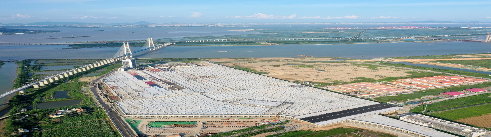
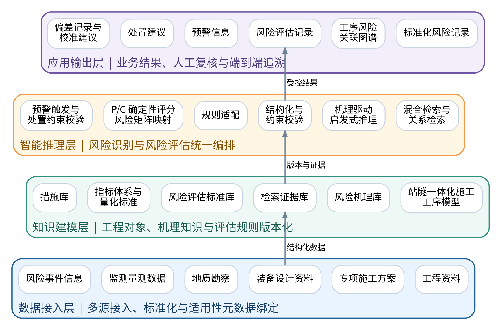
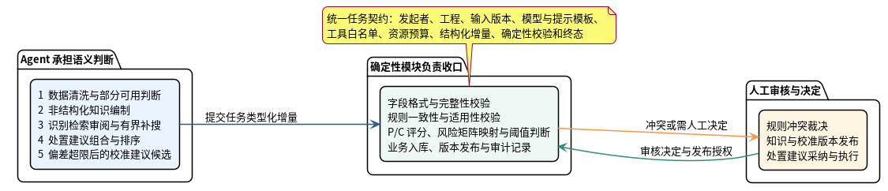
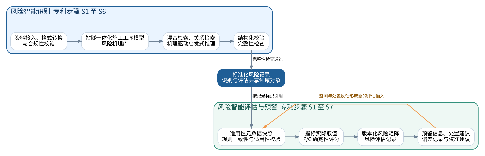
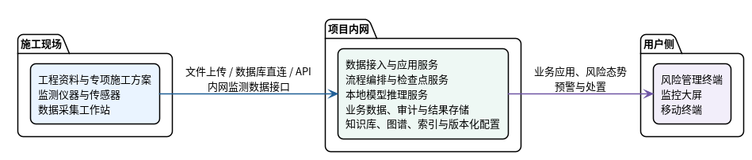
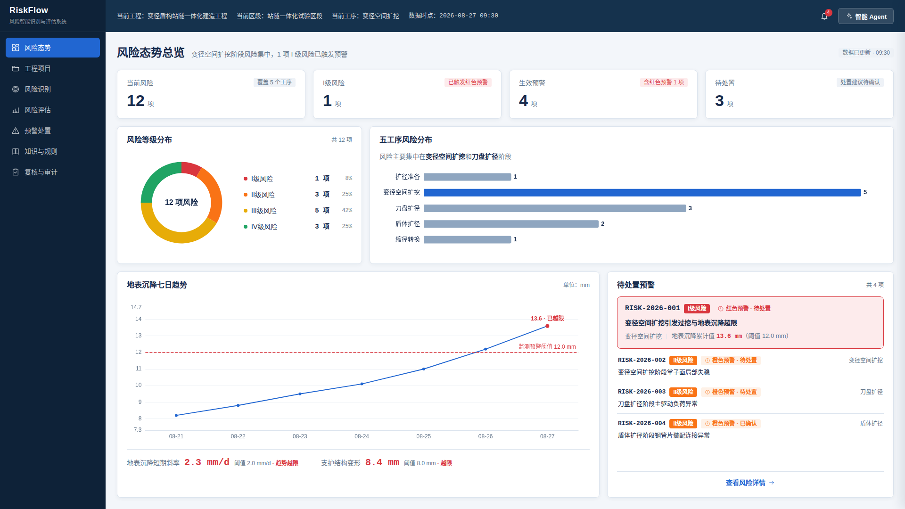
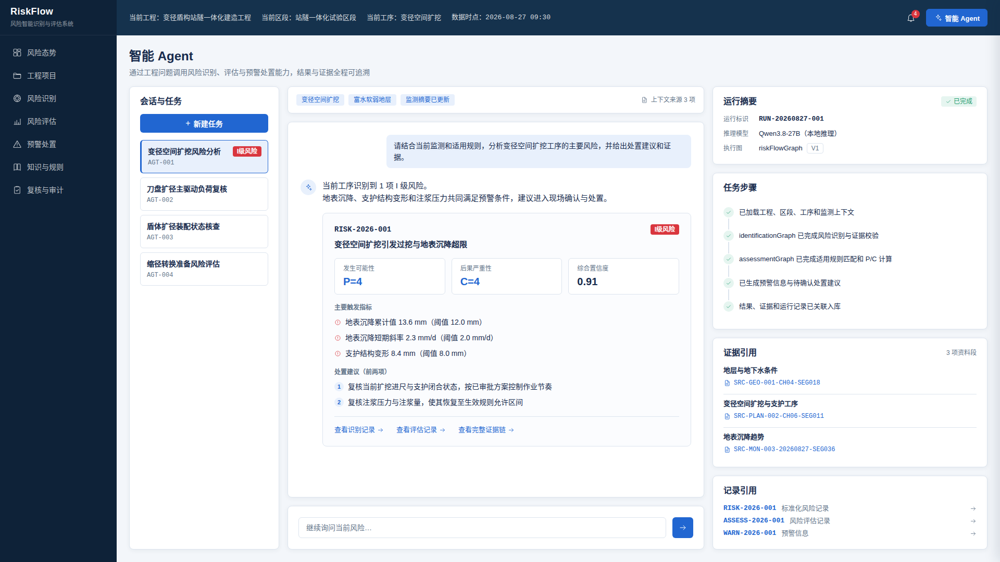
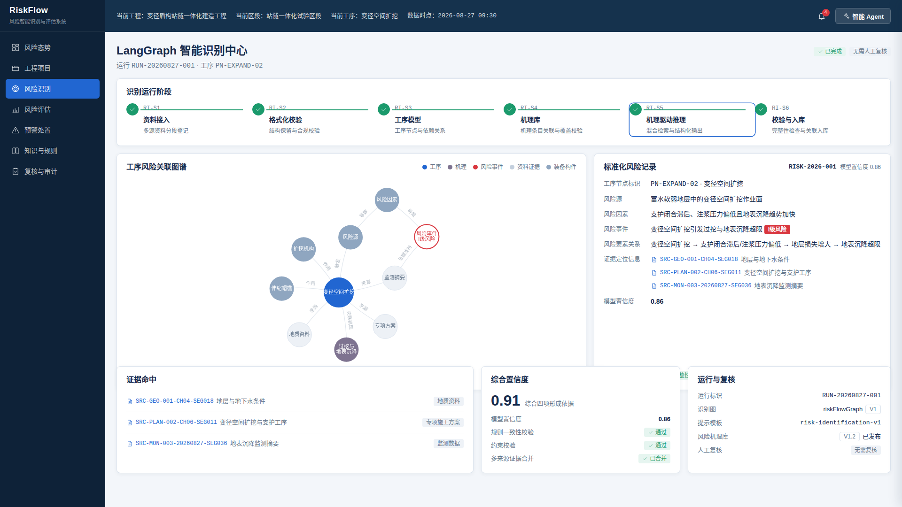
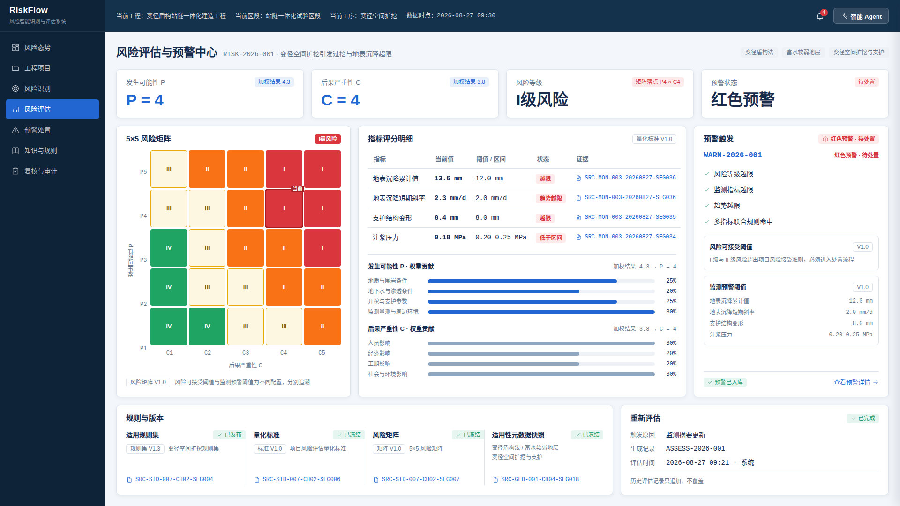
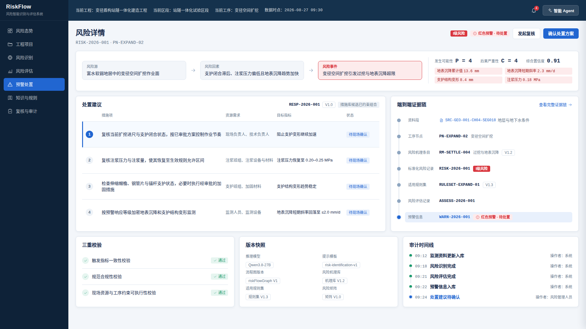

# 20260828变径盾构隧站一体化建造风险评估及安_系统设计汇报_优化版_2

- Source: `20260828变径盾构隧站一体化建造风险评估及安_系统设计汇报_优化版_2.pptx`
- Total slides: 19

## Slide 1

中国铁建股份有限公司地下空间利用领域科研计划项目 合同编号：2024-W08

变径盾构站隧一体化建造风险风险评估及安全控制技术研究

2026年度执行情况汇报

课题参研单位：中铁建华南建设有限公司

：

姜军

子课题负责人

2026年 月

## Slide 2

目录

CONTE NTS

基于变径盾构的轨道交通隧站一体化建造技术研究

2025年度执行情况汇报

课题总体情况

经费使用情况

下一步工作计划

课题研发进展

一

二

四

三

1

## Slide 3

- 中国铁建股份有限公司科技研发计划项目重点课题
- 基于变径盾构的轨道交通隧站一体化建造技术研究

一

一、课题总体情况

- 1. 课题概况
- 2. 团队组成及分工

## Slide 4

- 中国铁建股份有限公司科技研发计划项目重点课题）
- 基于变径盾构的轨道交通隧站一体化建造技术研究

一

二、项目研发进展

- 1. 组织管理机构
- 2. 目标计划分解
- 3. 年度任务完成情况
- 4. 各子课题工作进展
- 5. 年度工作成果

## Slide 5

2 项目研发进展

2.

4 各子课题工作进展--子课题一（站隧一体化建造风险智能识别与评估技术）

（1）站隧一体化建造风险智能识别与评估技术

研究目标

研发路线

围绕站隧一体化施工风险识别与评估需求，研发面向工程资料接入、风险智能识别、评估依据生成与风险管理协同的软件系统。

1

2

3

4

5

6

7

需求分析

对象建模

架构设计

接口设计

原型实现

测试验证

迭代交付

研发要点

当前阶段进展

明确业务需求与应用边界

明确了系统应用场景、输入资料范围、风险识别输出和管理系统衔接方式。

梳理了工程资料、工序信息、机理知识与风险记录之间的对应关系。

需求

资料

梳理工程资料与结果流转

搭建系统模块与接口关系

形成了数据接入、知识建模、智能推理、结果入库和系统管理的整体框架。

具备了开展样例资料接入、接口联调、结果复核和原型迭代的基础。

框架

验证

建立结果校验与沉淀机制

### Speaker Notes

本项研究的目标是把站隧一体化施工智能风险识别与评估的需求，落到一套可以运行、可以迭代的软件系统里。整体推进思路是先明确系统的业务需求和应用边界，比如系统服务什么场景、接收哪些工程资料、最终输出什么风险识别和评估结果；然后梳理工程资料、工序信息、机理知识和风险记录之间的流转关系，形成系统架构和接口关系；最后通过样例资料接入、接口联调和结果复核来验证系统是否可用。目前已经完成了需求明确、资料梳理、框架形成和验证准备等基础工作，后续可以进入原型开发和系统联调阶段。

## Slide 6

2 项目研发进展

2.

4 各子课题工作进展--子课题一（站隧一体化建造风险智能识别与评估技术）

（1）站隧一体化建造风险智能识别与评估技术

系统架构

系统特性

数据接入层

对象贯通

工程资料

专项方案

装备设计

地勘监测

施工日志

1

2

3

4

5

工序节点、风险因素、风险事件与证据片段统一编号，避免识别结果脱离工程对象。

知识建模层

施工工序模型

风险机理库

规范标准库

类比案例库

1

2

3

4

风险机理库把“致险因素—作用路径—监测指标—防控措施”固化为可检索知识。

机理约束

智能推理层

证据追溯

规则/仿真校验

混合检索增强

机理驱动提示

LLM风险推理

1

2

3

4

每条风险记录保留资料来源、规范条文、类比案例和模型置信度，支持复核。

动态入库

应用输出层

标准化风险记录

风险关联图谱

管理系统接口

追溯与复核

1

2

3

4

识别结果沉淀为工序风险关联图谱，动态写入风险管理系统

### Speaker Notes

系统整体分为四个层次：数据接入、知识建模、智能推理和应用输出。数据接入层主要处理工程资料、专项方案、装备设计、地勘监测和施工日志等多源信息；知识建模层负责形成施工工序模型、风险机理库、规范标准库和类比案例库；智能推理层通过检索增强、机理驱动提示和大语言模型推理识别潜在风险，并结合规则或仿真校验提高结果可靠性；最后在应用输出层生成标准化风险记录和工序风险关联图谱，并对接风险管理系统。整个系统强调四个能力：对象能贯通、机理有约束、证据可追溯、结果能动态入库。

## Slide 7

2 项目研发进展

2

2.4 各子课题工作进展 · 子课题一（站隧一体化建造风险智能识别与评估技术）

总体思路：机理驱动识别，规则约束评估

同类型案例不足

规则适用条件复杂

人工排查难追溯

新装备、新工法难以直接套用历史风险清单

工法、地层和工程阶段变化会影响规则选用

资料分散，识别依据和复核过程不易沉淀

风险管理业务闭环

资料接入

智能识别

智能评估

动态预警

处置反馈

反馈复核：形成知识更新或校准建议，审核后发布新版本

风险在哪里

风险有多大

风险如何处置

按工序节点检索机理与证据，形成标准化风险记录

按适用规则计算 P/C 分值，再映射版本化风险矩阵

根据触发指标形成预警和处置建议，跟踪实际效果

变径盾构站隧一体化建造风险智能识别与评估系统（RiskFlow）

7

> [SmartArt scan unavailable: Missing required PPTX part: ppt/slides/slide7.xml]

### Speaker Notes

变径盾构站隧一体化施工缺少同类型工程先例，风险识别不能只依赖历史清单。系统以施工工序和风险机理为识别依据，以版本化规则、指标和风险矩阵完成量化评估。监测更新、预警处置和效果反馈进入同一业务闭环，所有结论保留证据与版本信息。

## Slide 8

2 项目研发进展

2

2.4 各子课题工作进展 · 子课题一（站隧一体化建造风险智能识别与评估技术）

识别与评估一体化系统架构

共享事实源

工序、机理、证据和版本信息在各层之间按统一契约传递

确定性边界

P/C 评分、矩阵映射、阈值判断和业务入库不由大模型决定

人工复核

字段不完整、规则冲突、校准发布等场景显式暂停等待审核

变径盾构站隧一体化建造风险智能识别与评估系统（RiskFlow）

8

> [SmartArt scan unavailable: Missing required PPTX part: ppt/slides/slide8.xml]

### Speaker Notes

系统沿数据接入、知识建模、智能推理和应用输出四层组织。识别与评估共享工程对象、版本信息和证据链，但各自保持独立流程。智能推理负责流程编排和人工复核路由，评分公式、风险矩阵、阈值判断和业务入库由确定性领域模块执行。

## Slide 9

2 项目研发进展

2

2.4 各子课题工作进展 · 子课题一（站隧一体化建造风险智能识别与评估技术）

Agent 参与边界：语义判断、确定性计算与人工决策

五类必经 Agent 任务聚焦语义判断；计算、校验、发布和采纳均由受控模块或人工完成。

固定任务边界

限定工具范围

执行资源预算

保留审计证据

发起者、工程和输入版本在任务创建时确定

按任务类型配置领域工具白名单

模型、工具、并发和墙钟时间设硬预算

记录输入、工具行动、校验和正式结果，不展示思维链

变径盾构站隧一体化建造风险智能识别与评估系统（RiskFlow）

9

> [SmartArt scan unavailable: Missing required PPTX part: ppt/slides/slide9.xml]

### Speaker Notes

Agent 只参与需要语义判断、证据取舍或受限工具行动的环节。字段校验、规则校验、P/C 评分、风险矩阵映射、阈值判断和业务入库由确定性模块完成。规则冲突、知识发布、处置采纳和校准生效仍由人决定。

## Slide 10

2 项目研发进展

2

2.4 各子课题工作进展 · 子课题一（站隧一体化建造风险智能识别与评估技术）

识别与评估双引擎：从工程证据到预警处置

工序模型、风险机理条目和检索证据共同约束推理

适用规则集、指标实际取值、权重和版本化风险矩阵

偏差超限只生成校准建议，审核通过后形成新版本

识别依据

评估依据

反馈边界

变径盾构站隧一体化建造风险智能识别与评估系统（RiskFlow）

10

> [SmartArt scan unavailable: Missing required PPTX part: ppt/slides/slide10.xml]

### Speaker Notes

风险智能识别按识别专利 S1 至 S6 处理工程资料、构建工序模型和风险机理库，再通过检索增强与启发式推理形成标准化风险记录。风险智能评估按评估专利 S1 至 S7完成规则适配、P/C 评分、风险矩阵映射、预警和处置反馈。两条流程通过标准化风险记录衔接。

## Slide 11

2 项目研发进展

2

2.4 各子课题工作进展 · 子课题一（站隧一体化建造风险智能识别与评估技术）

技术实现与工程保障

流程编排

模型与检索

应用与领域工具

LangGraph

开源模型、LoRA、向量检索与 BM25

React、ECharts 与受限工具接口

统一组织识别和评估流程，支持检查点、重试、暂停与人工复核

模型用于工程文本抽取和受约束推理；双索引独立打分后融合

界面承载业务闭环；Agent 只能调用按任务授权的领域操作

工程保障机制

规格驱动

配置版本化

全链路审计

结果可重放

能力变更先形成可核对的规格

指标、权重、矩阵和阈值不写死

来源、规则、版本和审核过程可追溯

以输入快照和配置版本重现计算结果

变径盾构站隧一体化建造风险智能识别与评估系统（RiskFlow）

11

> [SmartArt scan unavailable: Missing required PPTX part: ppt/slides/slide11.xml]

### Speaker Notes

技术实现分为流程编排、模型与检索、应用与领域工具三个部分。流程支持暂停、恢复、失败重试和人工复核；模型推理受工程上下文与证据约束；现场数据仍通过文件上传、数据库直连或 API 接入，领域工具接口用于约束 Agent 可执行的操作。工程侧通过规格、版本、审计和重放四项机制保证结果可核对。

## Slide 12

2 项目研发进展

2

2.4 各子课题工作进展 · 子课题一（站隧一体化建造风险智能识别与评估技术）

项目内网部署建议：数据、模型与业务服务分区

数据边界

服务分区

按需配置

工程资料和监测数据保留在项目内网，外部通知在结果可靠入库后执行

业务应用、流程编排、模型推理和数据存储各自承担明确职责

模型规模、算力、主备和备份方案依据实施条件确定，不在设计页固定型号

变径盾构站隧一体化建造风险智能识别与评估系统（RiskFlow）

12

> [SmartArt scan unavailable: Missing required PPTX part: ppt/slides/slide12.xml]

### Speaker Notes

建议将现场数据采集、应用服务、流程编排、模型推理和数据存储部署在项目内网。工程资料可通过文件上传、数据库直连或 API 接入，监测数据通过内网数据接口接入。模型规模、GPU 数量、主备与备份策略在实施设计阶段根据数据量和并发需求确定。

## Slide 13

2 项目研发进展

2

2.4 各子课题工作进展 · 子课题一（站隧一体化建造风险智能识别与评估技术）

系统演示（一）：风险态势总览（演示原型）

数据入口

风险评估记录、预警信息和监测摘要按当前版本汇总

重点操作

筛选项目与工程阶段，查看风险分布、监测趋势和待处置事项

业务输出

定位风险集中工序和越限指标，并进入评估、预警或证据详情

变径盾构站隧一体化建造风险智能识别与评估系统（RiskFlow）

13

> [SmartArt scan unavailable: Missing required PPTX part: ppt/slides/slide13.xml]

### Speaker Notes

风险态势总览汇集当前风险数量、预警等级、工序分布、监测趋势和待处置事项。管理人员可按项目、阶段和风险等级筛选，定位越限趋势后进入风险评估记录、预警信息或证据追溯页面。该页面用于日常巡检和汇报，不替代具体风险记录的审核。

## Slide 14

2 项目研发进展

2

2.4 各子课题工作进展 · 子课题一（站隧一体化建造风险智能识别与评估技术）

系统演示（二）：智能 Agent 与智能识别（演示原型）

智能 Agent 工作台

智能识别中心

- 输入：工程问题、关联项目和资料版本
- 输出：评估结论、P/C 分值、触发指标及证据引用

- 过程：按工序节点展示检索、推理和确定性校验状态
- 输出：标准化风险记录、综合置信度和人工复核路由

变径盾构站隧一体化建造风险智能识别与评估系统（RiskFlow）

14

> [SmartArt scan unavailable: Missing required PPTX part: ppt/slides/slide14.xml]

### Speaker Notes

智能 Agent 工作台承接有边界的分析任务，展示任务状态、结论、指标和证据引用。智能识别中心按工序节点呈现识别步骤，模型输出经过字段与完整性校验后形成标准化风险记录。低置信度、证据不足或字段不完整的结果进入人工复核。

## Slide 15

2 项目研发进展

2

2.4 各子课题工作进展 · 子课题一（站隧一体化建造风险智能识别与评估技术）

系统演示（三）：风险评估、预警与处置追溯（演示原型）

风险评估与预警

处置与证据追溯

- 计算：指标实际取值形成 P/C 分值，映射当前风险矩阵版本
- 预警：记录触发类型、触发指标、证据和通知状态

- 处置：候选措施组合经过三项约束校验后提交采纳
- 追溯：资料段、工序、机理、评估、预警和处置连续关联

变径盾构站隧一体化建造风险智能识别与评估系统（RiskFlow）

15

> [SmartArt scan unavailable: Missing required PPTX part: ppt/slides/slide15.xml]

### Speaker Notes

风险评估页面保存适用性元数据快照、指标评分明细、P/C 分值、风险等级和所用版本。风险等级超过风险可接受阈值，或监测数值、趋势及联合规则越限时生成预警信息。处置建议在候选措施集内组合排序，通过触发指标一致性、规范合规性和现场可执行性校验后供人员采纳。

## Slide 16

2 项目研发进展

2

2.4 各子课题工作进展 · 子课题一（站隧一体化建造风险智能识别与评估技术）

阶段成果与近期验证重点

已形成设计基线

已完成演示原型

进入样例验证

统一领域术语与字段契约

风险态势与监测趋势

多源资料结构化转换

1

1

1

对应两项专利的方法步骤

智能 Agent 与智能识别

检索与评分结果核对

2

2

2

明确 Agent、确定性计算和人工审核边界

风险评估、预警处置与证据追溯

预警处置闭环联调

3

3

3

近期验证路径

样例资料到位

结构化与检索核对

P/C 与矩阵结果核对

预警处置闭环联调

验证使用甲方提供或审核的配置与脱敏样例；当前演示数据不作为正式评估结果。

变径盾构站隧一体化建造风险智能识别与评估系统（RiskFlow）

16

### Speaker Notes

当前成果主要分为设计基线和演示原型。设计基线已统一识别与评估的领域术语、字段契约、流程边界和追溯要求；演示原型覆盖态势总览、智能 Agent、识别、评估、预警处置等主要界面。下一阶段需要使用甲方资料、指标体系、风险矩阵和脱敏监测样例验证数据转换、检索、评分和闭环联调。

## Slide 17

- 中国铁建股份有限公司科技研发计划项目重点课题
- 基于变径盾构的轨道交通隧站一体化建造技术研究

一

四、下一步工作计划

> [SmartArt scan unavailable: Missing required PPTX part: ppt/slides/slide17.xml]

## Slide 18

四 下一步工作计划

四

四、下一步工作计划

下一步研究计划与关键条件

研究工作顺序

1 固化架构基线

2 实现资料解析

3 验证模型与检索

4 开展系统联调

确定语言版本、检查点持久化和部署形态

完成文本、表格、图纸标注和监测数据转换

完成模型选型、检索排序和识别结果复核

接入现场数据，验证评估、预警和处置闭环

正式验证所需条件

甲方业务配置

脱敏工程样例

合并与入库规则

识别评价指标

风险源清单、指标体系、量化标准和风险矩阵

设计资料、专项方案、施工日志和监测数据

多来源风险记录的判重、合并和综合置信度规则

准确性、完整性、可解释性与可追溯性评价方法

变径盾构站隧一体化建造风险智能识别与评估系统（RiskFlow）

18

### Speaker Notes

下一阶段先固化流程编排的语言版本、检查点持久化和部署形态，再实现多源资料解析、模型选型与检索验证，最后结合现场监测数据开展系统联调。甲方指标体系、风险矩阵、量化标准和脱敏监测样例是正式验证的必要输入；合并规则和识别评价指标需与专家复核机制同步确定。

## Slide 19

中国铁建股份有限公司地下空间利用领域科研计划项目 合同编号： 2024-W08

变径盾构站隧一体化建造风险评估及安全控制技术研究

谢谢！

- 中铁建华南建设有限公司
- China Railway Construction South China Construction Co.,Ltd
